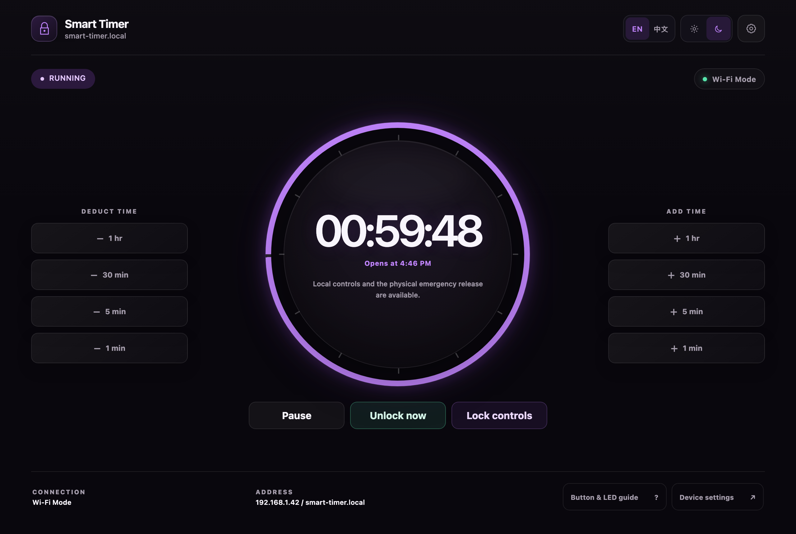
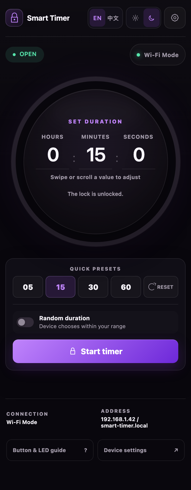
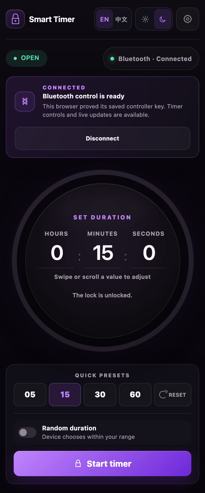
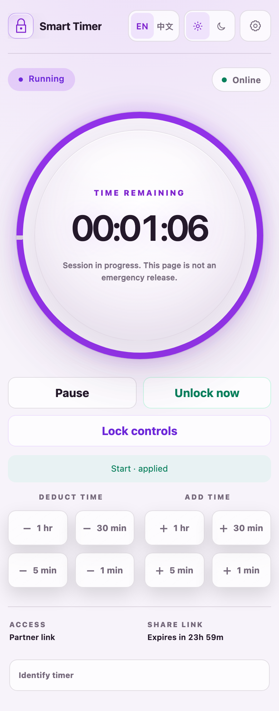
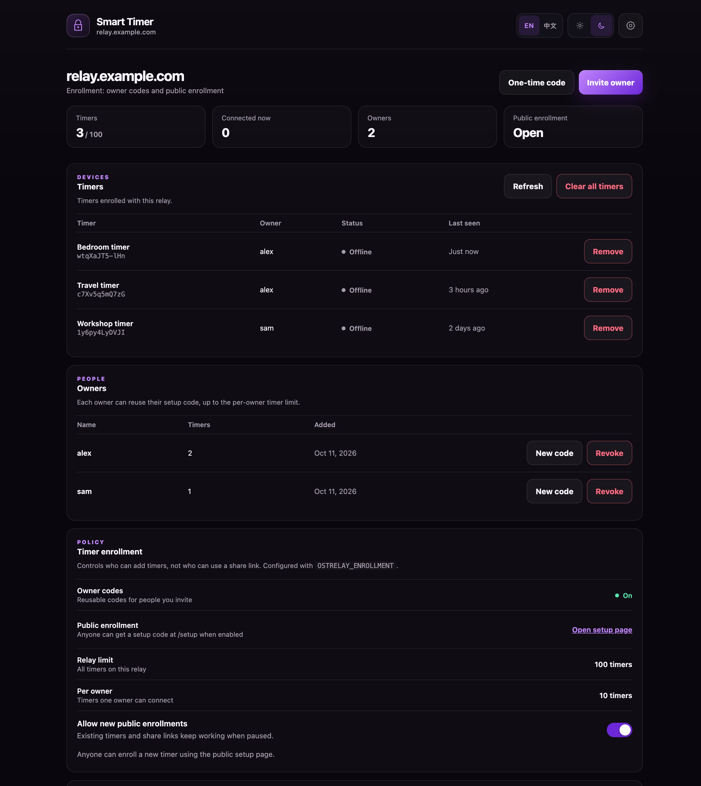

# OpenSmartTimer

Independently written replacement firmware for the **MagBound Smart Timer V1 (Legacy Timer)** and **MagBound Smart Timer V2**. Each model uses one application image containing the timer controller, web interface, Wi-Fi setup, OTA updater and HTTP APIs.

> [!WARNING]
> This unofficial experimental firmware controls a physical lock and can be used with human restraints. Failure to release can cause serious injury or death. Never rely on software, Wi-Fi, a timer, battery removal, or one emergency path as the only means of release. Power it from a battery only, never from a wall outlet, whenever it controls a lock. Never use it for self-restraint while alone. Read the [safety, warranty, and liability notice](SAFETY.md) before downloading, installing, distributing, or using it. The firmware is provided as is, without warranty of any kind; you install and use it entirely at your own risk.

**Status:** `1.0.0-rc.2`, a release candidate. Every published release, pre-releases included, is offered to every timer of that model when its owner checks for updates.

## Supported hardware

| Model | Power input | Controller | Control connections |
| --- | --- | --- | --- |
| MagBound Smart Timer V1 | 12 V DC barrel socket | ESP8266 ESP-12F | Local Wi-Fi/AP and HTTP API |
| MagBound Smart Timer V2 | USB-C | ESP32-C3 | Local Wi-Fi/AP, HTTP API, Bluetooth and experimental remote sharing |

Whenever the timer controls a lock, power it from a battery (a 12 V battery pack for the V1, a USB power bank for the V2) and never from a wall outlet; see the [safety notice](SAFETY.md#battery-power-only). The power connector is the quickest way to tell the two apart. The images are model-specific and cannot be interchanged. V1 and V2 identify hardware generations; the local API, Bluetooth protocol and relay protocol each use revision 1.

## Features

- Countdown up to 24 hours, pause/resume, time adjustment, random duration and one-way control locking.
- Physical emergency input that continuously commands release and blocks start/resume while asserted.
- English and Simplified Chinese interfaces, Purple/Slate/Teal palettes, light/dark appearance and touch, swipe, wheel and keyboard duration controls.
- Wi-Fi and access-point modes, router provisioning, configurable open/WPA2 AP and recovery AP.
- JSON REST API, live Server-Sent Events, current-boot history, diagnostics, mDNS and legacy-route compatibility.
- V2 Bluetooth control with encrypted bonding, application authentication and physical pairing approval for up to three apps, with one connection at a time.
- Physically armed firmware updates. Manual GitHub updates show release notes with Cancel/Install and verify signed metadata and the downloaded image.
- Experimental V2 remote sharing through time-limited links and a self-hosted relay, off by default.

All control connections use the same timer rules. The electronic release command does not confirm mechanical release; see [Safety](SAFETY.md) and [Hardware](docs/HARDWARE.md).

## Screenshots

The timer's own page, the Bluetooth app and the remote-sharing pages share one design, in light or dark and three color palettes. These were captured from the built-in preview and test fixtures, so every name and address shown is example data.

<p align="center"></p>

| Timer page | Bluetooth app | Partner share link |
| :---: | :---: | :---: |
|  |  |  |

<p align="center"></p>

## Getting started

1. **Read the [safety notice](SAFETY.md).** It applies before you download or install anything.
2. **Identify your timer** from the table above. V1 and V2 need different files.
3. **Download the file for your model** from [GitHub releases](https://github.com/xboarder56/OpenSmartTimer/releases): `OpenSmartTimer-<version>-MagBoundV1-ESP8266.bin` or `OpenSmartTimer-<version>-MagBoundV2-ESP32C3.bin`.
4. **Install it by following the [installation and recovery guide](docs/INSTALLATION.md).** In short: disconnect the lock, keep a copy of the original firmware, then upload the file through the timer's existing update page using the **Firmware** field only. Going back to the original firmware is possible only while the new firmware still starts, so read the guide's recovery limits first.
5. **Connect to the timer.** Join the network it creates, named like `SMARTTIMER-12AB34`, and open `http://192.168.4.1`. Add your Wi-Fi there, or keep using the timer's own access point.

Later updates are in **Device settings → Firmware** on the timer's page: check for a signed release or upload a file. Updating is designed to keep your network, device-name and Bluetooth settings.

The timer serves its own page and needs no account or Internet connection. **The HTTP interface has no login, TLS listener or API token. Anyone who can reach it can control it.** Use a trusted or isolated network. An AP password protects access to the AP; it does not authenticate requests on the router LAN. See [Security](SECURITY.md).

## Bluetooth and remote sharing

The [Smart Timer Bluetooth app](bluetooth-app/README.md) is an installable V2 browser controller. It requires a browser with Web Bluetooth support. Temporary Bluetooth-only mode suspends Wi-Fi/AP while retaining saved settings; networking returns when Bluetooth disconnects or resets, or when restored from the app.

**Remote sharing is experimental.** It is off by default and has had no independent security review, so treat it as a feature under evaluation rather than one to depend on. The owner runs a relay or chooses an operator they trust. **The project does not provide relay hosting.** One setup code supplies the relay address, independent HTTPS control-page address, enrollment code and server key pin. Review both addresses on the local timer page and briefly press Reset to approve the setup. Partners then open a share link and need no hosting of their own.

The trusted control page must be hosted with credentials and infrastructure isolated from the relay. A different port or container on the same host does not provide protection against compromise of that host. Start with [Remote sharing](docs/REMOTE_SHARING.md) and the [relay operator guide](relay/OPERATOR.md).

V1 has no Bluetooth or relay support. Timer-to-timer pairing and mirroring are not implemented.

## Build and contribute

V1 uses pinned stock ESP8266 packages. V2 uses a pinned, size-reduced ESP32-C3 framework package. [Building](docs/BUILDING.md) covers PlatformIO, Docker requirements and clean-checkout setup:

```sh
./scripts/build_framework_esp32c3.sh
./scripts/build_firmware.sh all
```

V1 can be built independently with `./scripts/build_firmware.sh v1`. Default V2 builds include relay support, inactive until the owner configures it; builds require no hosting address.

Install the [test dependencies](tests/README.md), then run:

```sh
./scripts/check.sh all
```

See [Testing and verification](docs/VALIDATION.md) for what the automated checks cover and how they differ from physical hardware verification. To preview the embedded interface without a timer, run `python3 tools/preview_ui.py`; add `--v2` for V2 features.

## Documentation

- [Documentation index](docs/README.md)
- [Installation, updates and recovery](docs/INSTALLATION.md)
- [API reference](docs/API.md)
- [Bluetooth app](bluetooth-app/README.md) and [app hosting](docs/GITHUB_PAGES.md)
- [Remote sharing](docs/REMOTE_SHARING.md) and [relay operation](relay/OPERATOR.md)
- [Hardware](docs/HARDWARE.md), [Architecture](docs/ARCHITECTURE.md) and [Security](SECURITY.md)
- [Changelog](CHANGELOG.md), [Contributing](CONTRIBUTING.md) and the [working guide](AGENTS.md) for contributors and coding agents

## Project layout

| Location | Contents |
| --- | --- |
| `src/`, `include/` | Controller, network APIs and hardware adapters |
| `web/` | Web interface embedded in both firmware images |
| `bluetooth-app/` | V2 Bluetooth browser controller |
| `relay/` | Relay server, independently deployed control page and tests |
| `tests/`, `scripts/`, `tools/` | Tests, builds, packaging and development tools |
| `docs/`, `framework/` | Guides, protocol references and pinned framework profile |

## License

Original project code—including firmware, Bluetooth web app and relay—is licensed under the [GNU Affero General Public License version 3](LICENSE) (`AGPL-3.0-only`), with the narrow [Espressif linking permission](LICENSE-ESPRESSIF-EXCEPTION). Our code and changes remain under AGPL; the permission allows firmware to include the identified vendor SDK binaries under their own terms. Third-party components retain their own licenses; see [THIRD_PARTY_NOTICES.md](THIRD_PARTY_NOTICES.md).

Everything here is provided **as is, without warranty of any kind**, and you install and use it entirely at your own risk: see sections 15 and 16 of the license and the assumption of risk, warranty disclaimer and limitation of liability in [SAFETY.md](SAFETY.md), which are additional terms under section 7(a) of the license. The rest of that notice is guidance; none of it is a guarantee of safety.
