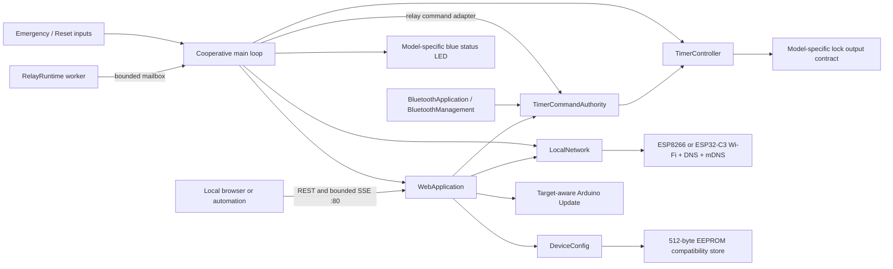
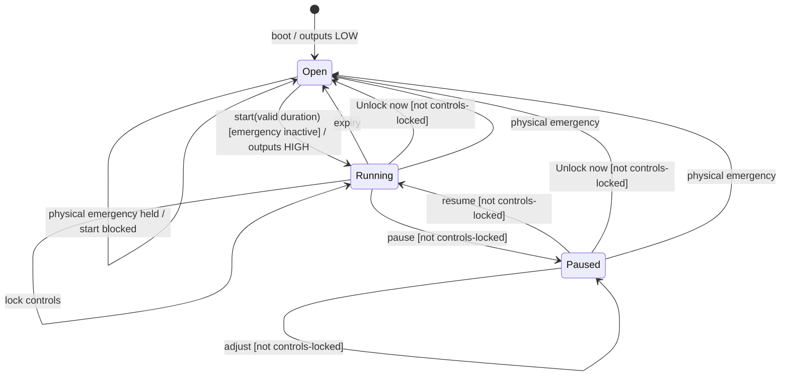
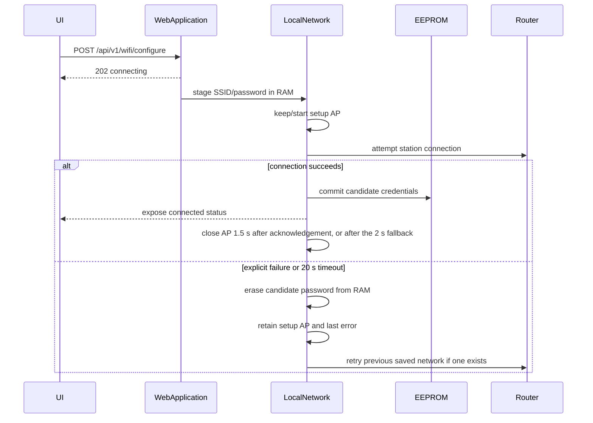

# OpenSmartTimer firmware architecture

## 1. Purpose and design boundaries

This project is an independently written replacement firmware for the **MagBound Smart Timer V1 (Legacy Timer)** and **MagBound Smart Timer V2**. Each model-specific application image contains the same timer controller, API, recovery/OTA logic, and compressed web interface behind narrow platform and GPIO contracts. Neither image is general-purpose ESP firmware, and the two images are not interchangeable.

The design is governed by five invariants:

1. **Fail open:** reset, power loss, boot, expiration, or physical emergency release must de-energize both lock-driver outputs.
2. **Physical release wins:** the model-specific emergency input continuously forces the outputs open and blocks start/resume; software control locking can never disable it.
3. **No provisioning lockout:** failed candidate Wi-Fi credentials are not committed, new AP settings are applied only after their response, and a ten-second physical Reset-button hold restores every user setting plus a generated open setup AP.
4. **Firmware writes require physical presence:** OTA works only during a five-minute window armed after a short Reset-button press is released while the timer is open.
5. **Rollback remains possible while this firmware boots:** exact previously verified vendor application images are accepted by pinned size/CRC metadata, and the untouched vendor filesystem can be reused after rollback. Vendor binaries are not redistributed in the source tree.

This firmware intentionally does not retain a running timer across reset. Restarting releases the output; that is part of the fail-open safety model.

These invariants describe intended and tested software behavior, not a safety certification or a guarantee that the assembled lock will release. See the [safety, warranty, and liability notice](../SAFETY.md).

## 2. System overview



The Arduino loop owns `TimerController`, physical inputs and every timer mutation. On V2, NimBLE callbacks hand bounded work to that loop, while the optional `RelayRuntime` FreeRTOS worker owns relay networking, TLS and signing. Relay commands cross a mailbox and execute on the Arduino loop through `TimerCommandAuthority`; the worker never accesses the timer directly. The platform networking and BLE stacks also use framework-managed tasks.

## 3. Hardware and flash contract

Named product profiles live in `include/boards/`, with product image/layout
constants in `include/flash/`. `BoardProfile.h` selects the target at compile
time and rejects crossed targets/toolchains or overlapping active GPIO roles.
`Hardware.h` owns the unchanged runtime fail-open GPIO sequence; `Platform.h`
and `OtaImageValidation.h` consume the selected identity/header contract.
See [compile-time product contracts](BUILDING.md#compile-time-product-contracts).

| Function | V1 ESP8266 | V2 ESP32-C3 | Safety behavior |
| --- | ---: | ---: | --- |
| Lock output | GPIO4 + GPIO13 | GPIO3 | Latches preloaded LOW before output mode |
| Amber indicator | Driver-associated | GPIO6 | Follows commanded energized state |
| Blue indicator | GPIO12 | GPIO5 | Preloaded LOW; network/maintenance only |
| Emergency input | GPIO10 | GPIO0 | Immediate assertion, debounced release, continuous start/resume interlock |
| Reset button | GPIO5 | GPIO4 | Short release arms OTA; ten-second hold restores user settings while open |
| Auxiliary input | Unverified | GPIO1 | Initialized as input but deliberately inactive |

V1 pins ESP8266 Arduino core 3.1.2 through PlatformIO `espressif8266@4.2.1`, DOUT, 40 MHz, and `eagle.flash.4m2m.ld`. V2 pins Arduino-ESP32 3.3.0/ESP-IDF 5.5 through pinned pioarduino platform `55.03.30-2`, DIO, 80 MHz, and the original 4 MB default partition table. Its ESP32-C3 libraries are generated from the commits, patches, resolved dependency lock, container digest, and reduced configuration in `framework/esp32c3`; PlatformIO consumes that verified target-only package through a V2-scoped `platform_packages` override. V1 uses a separate core cache and never sees that override.

Changing either core also changes its Espressif Wi-Fi stack and requires a separate hardware qualification cycle. No application-level check can recover an image that fails before Wi-Fi/AP startup.

Carrier-board controls, accessory jacks, confidence levels, and the supported LED patterns are maintained in the [hardware reference](HARDWARE.md). Electrically unverified controls are not assigned to application behavior.

## 4. Boot and runtime sequence

`setup()` orders initialization so the outputs reach their safe state before any subsystem that may allocate, block, or fail:

```mermaid
sequenceDiagram
    participant CPU as ESP reset
    participant T as TimerController
    participant G as GPIO
    participant C as DeviceConfig
    participant N as LocalNetwork
    participant W as WebApplication

    CPU->>T: begin()
    T->>G: preload LOW, then configure outputs
    T->>T: state = Open; record boot event
    CPU->>C: validate checksummed records
    CPU->>N: start saved station attempt or setup AP
    CPU->>W: register routes and start HTTP server
```

Each `loop()` iteration performs:

1. Physical input handling: immediate emergency assertion (including an interrupt-latched edge), debounced emergency release, and debounced Reset-button gesture tracking.
2. Timer expiration check.
3. Pending relay-aware factory-reset work, then DNS, Wi-Fi connection, recovery AP, and mDNS maintenance; V2 also services delayed Bluetooth startup.
4. Status/identify LED selection.
5. One HTTP-server service pass, bounded SSE-client service, and deferred network/restart actions.
6. V2 Bluetooth commands, management, pairing and event replay.
7. Relay mailbox/command service when compiled in, including the local-Bluetooth priority gate.
8. V2 post-update boot-health confirmation, then a one-millisecond cooperative yield.

Network changes and restarts are scheduled after their HTTP response, avoiding a connection teardown before the client receives acknowledgment.

## 5. Timer state machine



Important rules:

- Duration must be 1–86,400,000 ms.
- Starting is allowed only from `Open`; an active timer cannot be silently replaced.
- A raw emergency HIGH rejects an energizing transition immediately. A held input at boot or asserted before start keeps both outputs LOW until its debounced release.
- An edge interrupt on the emergency pin also drives the lock outputs inactive directly from the ISR (register writes, IRAM) and latches the edge. The next loop pass performs the normal Emergency release even if a momentary contact has already opened again, and a pending edge blocks start, resume and extension until then. This covers presses shorter than a loop stall such as a Wi-Fi mode change. On V2 the framework's GPIO ISR service is not IRAM-resident, so the interrupt is deferred during flash writes. Updates, pairing and configuration writes require an open timer, but Bluetooth can still write flash during a session (a bonded reconnect stores its subscriptions; a repeated pairing attempt removes an old bond). The GPIO latches the edge, so a press during such a write takes effect when the write ends.
- The Arduino loop task is subscribed to the task watchdog with a 20-second window on V2 (the ESP8266 core's own watchdog covers V1). A hung loop reboots, which leaves the outputs inactive.
- Pause, resume, adjustment, and software opening are rejected once controls are locked.
- A paused timer cannot be locked because it would never expire without software intervention.
- Adjustment to zero releases the output.
- Deadline comparison uses signed subtraction so normal operation remains correct across `millis()` wraparound.
- `session_duration_ms` retains a progress baseline for clients that reload during a session.

The timer retains up to 16 chronological events in RAM. Each receives a nonzero current-boot sequence ID before entering the ring. The ring buffer is bounded, contains no dynamic strings, and is cleared by reboot. Emergency input activation and clearing are separate edge events; activation may be followed by `emergency_release` when an active output was forced open. A second nonzero counter advances only after a successful start and forms the session identity together with `boot_id`; neither counter writes flash.

## 6. Indicator responsibilities and priority

The amber hardware indicator represents the energized lock driver. The target-specific blue output provides network/maintenance status independently.

While the timer is open, temporary maintenance feedback overrides the normal blue network indication in this priority order:

1. Reset button held for settings reset: alternating 300 ms feedback, accelerating to 120 ms after eight seconds.
2. Active firmware transfer/validation: solid blue, followed by an 80 ms ON / 80 ms OFF accepted-and-restarting blink.
3. Active identify request: rapid 125 ms identification blink for five seconds.
4. Unverified OTA override: three 100 ms flashes every two seconds.
5. Ordinary OTA armed: two 100 ms flashes every two seconds.

At all other times the blue indicator reports network availability:

1. Connected station Wi-Fi: solid ON.
2. Intentional standalone AP Mode: solid ON.
3. Recovery AP while a saved Wi-Fi network is unavailable: 500 ms ON / 500 ms OFF.
4. Neither station Wi-Fi nor an AP available: fast 150 ms reconnect blink.

Identify and OTA can be initiated only while open. If a timer starts during either authorization window, the blue indicator immediately returns to network status while the amber indicator represents the active lock driver. Once an authorized upload starts, synchronous chunk processing writes blue ON directly so browser traffic cannot leave it stranded in the OFF phase of the earlier armed pattern; the normal loop takes over for the accepted/restarting blink. Releasing the Reset button within two seconds arms OTA; a second short press during that same window enables the volatile one-upload validation override. Continuing to hold the button does not arm OTA. On V2, a 3–5 second hold opens physical-confirmation Bluetooth pairing instead. Reaching ten seconds atomically restores the station, identity, AP, and supported Bluetooth records, then restarts with the default name and generated open AP. Firmware and the vendor filesystem are not changed. Amber is never used for maintenance feedback: the hardware contract ties it to lock-driver energization, so blinking it could pulse the controlled output.

## 7. Persistent configuration

The Arduino EEPROM compatibility layer is opened as 512 bytes. On V1 it maps to the core's fixed emulated-EEPROM flash sector, so the project-specific storage object retains the exact location used by earlier OpenSmartTimer releases. On V2 it is backed by the project-specific NVS namespace and blob key `opensmarttimer`, avoiding the generic `eeprom` namespace and isolating these records from vendor Preferences data. Three independent packed records use the same logical offsets on both targets:

| Offset | Record | Contents | Validation |
| ---: | --- | --- | --- |
| `0` | Wi-Fi v2 | magic, version, 32-byte SSID, 64-byte password, CRC32 | Existing format retained unchanged |
| `128` | Identity v1 | magic, version, 32-byte display name, CRC32 | Invalid/missing record defaults to `Smart Timer` |
| `192` | Access point v1 | magic, version, generated-name flag, 32-byte SSID override, 63-byte WPA2 password, CRC32 | Invalid/missing record defaults to generated open AP |

Separating identity, station Wi-Fi, and AP settings is an upgrade-safety decision: adding AP security cannot invalidate or erase an already-provisioned station or identity record. An older installation sees the new AP record as missing and safely creates the open default.

The display name is limited to 1–32 printable ASCII characters. A lowercase DNS-safe hostname is derived by replacing separator runs with a hyphen and limiting it to 24 characters. The default remains `smarttimer`, preserving `smarttimer.local`. The setup SSID is the uppercase hostname plus the chip ID.

Station and AP passwords are never returned by an API, diagnostics, status, or event endpoint. `ap_password_set` reveals only whether WPA2 credentials exist.

## 8. Wi-Fi and recovery state machine

V2 additionally keeps the radio preference at compatibility offset 320 and a
versioned `ble_apps` NVS blob in the same `opensmarttimer` namespace. The blob
holds three independent app credentials, labels, resolved peer identities,
non-reused credential IDs, and a CRC. Migration retires the old single key only
after durable registry commit. Factory reset journals intent in this registry
before clearing the compatibility store and completes interrupted resets on
next boot. See [Bluetooth](BLUETOOTH.md) for downgrade and bond-table handling.

On boot with no saved station SSID, the device starts its configured AP and captive DNS. New/migrated devices use a generated open AP; users may select a custom SSID and WPA2 password. With saved router credentials, firmware initially attempts station mode. If that network is unavailable for 20 seconds, the configured Recovery AP starts. Because AP and station operation share one 2.4 GHz radio on both controllers, automatic reconnect is disabled while the Recovery AP is active. Explicit 30-second saved-network attempts are deferred whenever an AP client is connected, then resume after the AP is unused. A newly submitted candidate network is still tested immediately.

Provisioning uses a staged transaction:



`wifi_state` is one of `standalone`, `connecting`, `connected`, `failed`, `disconnected`, or V2-only `disabled`. `network_mode` distinguishes saved `ap`/`wifi` operation and the temporary `bluetooth` override. `ap_role` is `primary`, `recovery`, or `off`, and `station_retry_paused` makes AP-client protection explicit. SSID fields distinguish the saved, currently targeted, last attempted, and connected networks. The password is not returned.

An authenticated BLE management request may suspend both Wi-Fi station and AP while the timer is open. This sets a RAM-only flag, stops DNS/mDNS and suppresses automatic reconnect/recovery-AP work. Saved credentials and AP settings are retained without flash writes. The app offers this only when Wi-Fi status advertises `wifi_suspend_supported: true`; there is no HTTP suspend/resume endpoint. Current V2 reports `wifi_disconnect_restore_supported: true` and restores saved networking on BLE disconnect or host reset. A latched disconnect survives rapid reconnection; radio operations run on the main loop, including while timer controls are locked. Resume over BLE and restart/power-cycle also restore networking. Saved router mode retains its recovery AP fallback. Older firmware without this flag requires explicit resume or restart. Suspending during a scan, credential test or pending post-update validation is rejected; Bluetooth cannot be turned off while it is the only connection mode. See [Bluetooth management](BLUETOOTH_MANAGEMENT.md#temporary-bluetooth-only-mode).

mDNS is closed and recreated when the active interface changes so the selected hostname binds to the correct AP or station interface.

The short success handoff avoids cutting off the captive-browser request that reports a valid connection. The first successful status response starts a 1.5-second grace period so the reconnect screen can paint; without an acknowledgement, the handoff closes after two seconds. Repeated polling cannot extend either deadline.

AP configuration is a separate checksummed transaction. `PUT /api/v1/wifi/ap` validates a printable 1–32 character custom SSID and either open security or an 8–63 character WPA2 passphrase, commits it, responds with the exact next SSID/security, and schedules restart 1.5 seconds later. Existing passwords can be retained without being returned. Its optional `standalone=true` input also clears the station record before that restart, allowing the UI's single network-mode card to switch to AP Mode atomically. The browser renders reconnection instructions from the response before its current connection disappears.

API “forget Wi-Fi” clears only router credentials and preserves the chosen AP configuration. The physical ten-second factory reset is intentionally broader: it restores router/AP settings, `Smart Timer` identity, and supported Bluetooth settings. V1 uses its unchanged single compatibility-store commit; V2 journals reset intent across its registry and compatibility-store commits. There is no remote factory-reset endpoint; destructive recovery requires physical presence.

## 9. HTTP and API architecture

`WebApplication` remains one lifecycle owner, split into translation units so
transport, parsing, responses and route behavior can be reviewed independently:

| File | Responsibility |
| --- | --- |
| `src/WebApplication.cpp` | Startup/loop, state observation, static UI, OTA and deferred network/restart work |
| `src/WebApi.cpp` | Modern/legacy routes, REST parameter parsing, operation-ID replay and REST error codes |
| `src/TimerCommandAuthority.cpp` | The timer-mutation rule set shared by REST, BLE and the relay adapter, plus the reusable operation-ID ledger |
| `src/WebManagement.cpp` | Authenticated BLE management adapter into shared web routes, bounded JSON replies, temporary network mode and BLE OTA handling |
| `src/BluetoothManagement.cpp` | BLE management framing, authentication, replay and dispatch on the main loop |
| `src/WebRelay.cpp`, `src/relay/RelayRuntime.cpp` | Owner HTTP routes and the relay worker/mailbox boundary; timer commands execute on the main loop |
| `src/WebStatus.cpp` | JSON status, diagnostics, capabilities, events and Bluetooth management responses |
| `src/WebRequests.cpp` | Origin/transition checks and one validated input source per request |
| `src/HttpRequestFields.cpp` | Allocation-free, bounded flat-JSON parser, Unicode decoding, route field types and integer bounds |
| `src/WebEventStream.cpp` | Fixed SSE slots (two on V1, three on V2), one frame in flight at a time, HTTP chunk framing, deadlines and partial writes |
| `include/CooperativeWebServer.h`, `src/CooperativeWebServer.cpp` | V1 ordinary HTTP reply ownership, bounded writes and explicit connection aborts |
| `include/SseWriteCursor.h`, `include/SocketWrite.h` | Host-testable write progress and the V2 single nonblocking socket send |

This is a scoped extraction, not a new framework or a change to public
legacy response formats. `TimerController` remains the sole timer/output owner;
none of the REST, BLE or relay transports directly energizes GPIO.

V1 uses a small adapter around the pinned ESP8266WebServer request parser.
It owns one complete RAM reply, or a header plus a pointer to a static flash
asset, and queues at most 512 bytes per loop with a zero socket-write timeout.
No next request is parsed while that reply is pending. A five-second absolute
deadline bounds backpressure; timeout, disconnection or allocation failure
aborts the socket rather than appending another response after missing bytes.
Successful completion refreshes the SDK's keep-alive idle deadline. Scheduled
network changes and restarts defer until completion or failure; timer ticks,
physical inputs and the separately bounded SSE writers remain active.
V2 retains its existing ordinary HTTP server and BLE/relay transports.

Modern REST mutations, BLE control commands and relay commands call
`TimerCommandAuthority::execute`. Transports keep only what differs between
them: authentication, framing, parameter parsing, their own retry records, the
shared system-transition gate and the mapping to their wire codes. The authority
checks, in order: parameters; boot then session precondition; requested state
already true (accepted no-op); software controls lock; timer state; emergency
input for start, resume and positive adjust; and the 24-hour maximum. A new
transport reuses the same class; the relay's `TimerAuthorityControl` already
does so. Legacy V1-compatible routes keep their
historical behavior and do not use it.

The target core's synchronous web server (`ESP8266WebServer` or `WebServer`) listens on plain HTTP port 80. The modern API uses JSON responses. Mutations accept URL-encoded form fields and a limited flat JSON object; nested objects and arrays are not accepted as mutation inputs. OTA remains multipart form data.

The SSE endpoint stays on the same origin and port as REST. V1 uses the ESP8266 server's request hook to transfer the underlying `WiFiClient`; V2 copies the reference from the already-parsed ESP32 route. Both place it into one of the fixed slots (two on V1, three on V2) so the synchronous server resumes accepting REST. Viewers take turns: one frame is in flight at a time, which keeps the V1's heap from holding a copy per viewer at once. Both models check the request's `Host` before accepting a stream. The indefinite HTTP/1.1 response uses explicit chunked transfer framing. Each client has bounded request/write behavior and a 15-second full-status refresh. There is no dynamic client container or unbounded event queue. A fourth stream receives HTTP 503 while REST remains available.

Each slot advances at most 512 output bytes per loop. V1 uses its implemented
`availableForWrite()` with zero write timeout; V2 uses one `send(MSG_DONTWAIT)`
because its inherited `Print::availableForWrite()` always returns zero. Headers
and frames have a five-second total write deadline, including partial-progress
peers. A pending chunk is immutable until finished, capped at 3,072 bytes per
slot; newer state is coalesced into the next frame. V1 incoming headers are capped
at 2,048 bytes/two seconds and read at most 256 bytes per loop. Stalled streams
are closed without waiting for an ACK. Rejection responses are small bounded
best-effort writes; actual RF/backpressure qualification remains required.

Every stream begins with a complete status snapshot. `boot_id` is generated once per boot without a flash write. `state_revision` advances when observed timer/network/device state changes, and `latest_event_id` exposes the newest ring sequence. Emergency input edges record an event, so they advance both the detailed-event cursor and the next full-status SSE frame. The SSE ID combines all three as `<boot>:<event>:<state>`. Together they let clients reject stale updates, fetch missed detailed events by cursor, and distinguish a revision reset from an ESP reboot; the design does not retain an SSE replay queue. OTA quieting closes all stream slots before upload work. Reboot or physical factory reset also destroys all volatile stream state.

Each successful timer start receives `session_id=<boot_id>-<session_sequence>`. Every modern timer mutation may send `if_boot_id`; a mismatch returns `stale_boot`, preventing a delayed pre-reboot command from acting on the current boot. Active-session mutations may additionally send `if_session_id`; a mismatch returns `stale_session` before any state transition. This prevents a delayed request for an earlier timer from reaching a newer one. Every modern timer mutation may also carry `operation_id`. A fixed eight-entry current-boot ring stores the ID, operation kind, and canonical integer inputs of successful commands. An exact replay returns current full state with duplicate metadata and performs no transition; reuse with another command or inputs is rejected. The ring is checked before the boot/session preconditions so retrying an already-completed command remains unambiguous. Legacy response bytes and behavior remain unchanged.

Station disconnect, got-IP, and DHCP-timeout callbacks populate bounded current-boot counters and the latest SDK reason without allocating an event queue or writing flash. Explicit disconnects initiated by Wi-Fi reconfiguration are marked expected for a short window. Only unexpected disconnects and DHCP timeouts enter the 16-slot event ring, where they also wake SSE; detailed counters, timestamps, raw reason, and normalized reason name remain in the on-demand diagnostics endpoint rather than the primary UI/status payload. Every ring entry snapshots its event-time timer state, controls-lock flag, emergency input, and session sequence so later HTTP or BLE replay cannot combine a historical event with current state.

Browser mutations are permitted only when `Origin` is absent or exactly `http://<Host>`, and requests explicitly marked cross-site are rejected. This reduces browser-based cross-site request attacks but is not authentication. CLI and home-automation backends normally omit `Origin` and remain compatible.

The device deliberately has no login, API token, TLS endpoint, or permissive CORS. It belongs on a trusted or isolated local network. mDNS publishes both generic `_http._tcp` and typed `_smarttimer._tcp` services. The typed record includes only non-secret API/version/identity/path metadata.

API responsibilities are divided as follows:

- `/api/v1/status`: compact serialized UI polling data with client-side jitter.
- `/api/v1/wifi/scan`: asynchronous scan start/state/results.
- `/api/v1/wifi/status`: provisioning/network details.
- `/api/v1/wifi/ap`: write-only-secret AP configuration and recovery metadata.
- `/api/v1/system/diagnostics`: less frequently requested support data.
- `/api/v1/events`: bounded current-boot history with event IDs, boot-aware cursors, and explicit truncation/reset indicators.
- `/api/v1/events/stream`: explicitly opened SSE full-status feed for two clients on V1 and three on V2; never persistent or active without a connected client.
- `/api/v1/capabilities`: machine-readable feature discovery.
- Action routes: explicit mutations with state checks, complete resulting JSON status plus mutation metadata, optional boot-scoped operation IDs, and optional active-session preconditions. `/timer/release` is the preferred semantic alias for the retained `/timer/stop` route.
- Legacy routes: preserved text formats required by existing vendor clients; no fields are appended to their response bodies.

### Experimental relay (V2)

The V2 image compiles `src/relay/` (headers in `include/relay/`), off by default. When the
owner enables it, `RelayRuntime` starts a FreeRTOS task that owns the relay
client, link table, TLS connection and signing; the Arduino loop remains the
only thread that touches `TimerController`. Relay commands cross a mailbox and
are applied on the loop through `TimerCommandAuthority` with the shared
transition gate, so remote, REST and BLE commands obey one rule set. The owner
API lives in `src/WebRelay.cpp`; `SMART_TIMER_RELAY` appears only at the
wiring points `check_repository.py` allows. See
[RELAY_FIRMWARE.md](RELAY_FIRMWARE.md).

## 10. OTA transaction and rollback

OTA is available only when the timer is open and a press of the Reset button is released within two seconds, arming a five-minute window. A second short press while armed permits one otherwise-unrecognized ESP application. Both authorization levels are volatile, share the original expiry, and are consumed when an upload begins.

The upload transaction is intentionally stricter than the stock updater:

1. Optionally preflight the declared byte length and CRC32, then reserve a ten-second quiet window. Bundled control pages receiving `ota_in_progress` back off for 30 seconds before polling again.
2. Verify same-origin policy, open timer, and physical arm window when the upload begins.
3. Require declared byte length and CRC32, and require them to match an active preflight reservation.
4. Reject a length larger than the available OTA slot.
5. Inspect the image header for the selected target: ESP8266/DOUT/4 MB/40 MHz for V1, or chip ID 5 ESP32-C3/DIO/4 MB/80 MHz for V2.
6. Stream CRC32 and scan for the project marker while extending the quiet window.
7. Keep one upload chunk unwritten so an invalid image is never complete enough for `Update.end()` to commit.
8. Accept either the target-specific project marker or an exact size/CRC match for one of the previously verified vendor rollback applications. OpenSmartTimer development builds are not fingerprinted in the runtime allowlist, so version changes do not require adding old project CRC values. When the second physical press enabled unverified mode, bypass only this marker/allowlist decision; all preceding structural and integrity checks remain mandatory.
9. Write the held chunk only after every validation passes, commit through eboot, respond, and wait 1.5 seconds before restart.

The updater never writes the filesystem or persistent-configuration areas. Smart Timer upgrades therefore retain station Wi-Fi, device name, and AP settings. Rolling back means uploading an allowlisted vendor **main firmware** first; its original two-field updater can then restore the matching filesystem only if necessary, although that vendor application may interpret or replace other retained settings differently.

V1 eboot provides no boot-success confirmation. On V2 the application overrides Arduino's normal early confirmation and waits until fail-open GPIO initialization, persistent storage, a station or recovery AP, and the web server have all remained ready for five seconds. It then confirms a pending image through the ESP-IDF OTA API. This closes the application-level window in which Arduino would otherwise validate before local recovery is available.

That guard does **not** prove automatic rollback. An application OTA does not replace the installed vendor bootloader, and rollback to the previous slot occurs only if that bootloader was compiled to honor pending OTA states. If the state is already non-pending, the application records the gate as finished without claiming rollback capability. USB-C is treated as power-only; an image that cannot initialize far enough for Wi-Fi may still require inaccessible, unverified 3.3 V UART access. Therefore unverified mode is never remotely armable or persistent, uses a distinct triple-blue signal, and requires an additional UI confirmation. CRC32 proves transfer integrity only; it does not authenticate an image or establish GPIO compatibility.

## 11. Web interface design

The interface assets—HTML, CSS, application JavaScript, localization and appearance modules—are gzip-compressed during the PlatformIO pre-build and linked into application flash. The timer-hosted shell requires no external assets or services. The Bluetooth app reuses `web/styles.css`, `web/i18n.js` and `web/appearance.js`; the separately deployed relay keeps its own CSS and an identical appearance module.

The UI:

- opens one SSE connection automatically per UI page, pauses serialized status polling once live, and retains REST polling as its failure fallback while reconnecting with jitter;
- keeps language and light/dark selections in per-tab `sessionStorage` for the timer page and Bluetooth app; the relay keeps its light/dark selection in browser `localStorage`;
- offers Purple (default), Slate and Teal palettes, each with light/dark appearance, in Settings → Appearance on the timer/Bluetooth app and the relay header menu; palette choice is stored per browser origin in `localStorage` as `smartTimerPalette`, synchronizes across same-origin tabs and falls back to memory if storage is unavailable; appearance changes never write ESP flash;
- switches language in place, preserving unsent duration/network settings, focus and the existing transport; shared text bindings retain original message keys without recreating forms or reloading the Bluetooth app;
- uses square language, light/dark and settings buttons beside the title/status chip, with a separator below the header;
- groups Identify LED and Restart device under Diagnostics in the timer and Bluetooth settings; availability still follows connection and timer state;
- interpolates the countdown locally between responses;
- keeps a readable connection/settings shortcut above the timer on phones; a failed status request or more than 25 seconds without a snapshot displays an explicit unknown-state warning, replaces the countdown with dashes and retries through REST if an SSE stream stalled (normal full snapshots arrive at least every 15 seconds);
- waits for a device-confirmed state transition at estimated expiry; reaching zero locally does not claim a confirmed unlock;
- ignores stale out-of-order poll responses;
- disables mutations during requests or while offline;
- validates fixed and random durations before sending;
- keeps the random-range labels separate from the swipe/scroll hint and gives Reset protected width without offsetting the quick-presets row;
- presents a prominent, translated maximum-duration banner and maps API `maximum_duration_reached` errors to it;
- lets touch users swipe vertically and mouse/trackpad users scroll fixed hour/minute/second values and random minimum/maximum values, while preserving tap-to-type and keyboard input;
- calculates `Opens at` using the browser's local clock;
- uses one reusable confirmation dialog for irreversible/disruptive actions;
- traps keyboard focus and marks background content inert while a dialog is open;
- exposes Wi-Fi results as ordinary keyboard-focusable buttons;
- computes firmware CRC32 in the browser before OTA;
- preflights OTA metadata, lets other control pages back off, and recommends a single AP client for flashing;
- starts Wi-Fi scans asynchronously and polls their bounded state/result object;
- adds a small random delay to serialized status polling so multiple clients do not synchronize;
- prompts on first-run standalone/AP mode;
- presents Wi-Fi Mode and AP Mode explicitly, with temporary Bluetooth-only control available through authenticated V2 Bluetooth management;
- shows the AP's SSID, open/WPA2 state, and connected client count only while an AP is actually broadcasting; configured standby values stay in network settings;
- renders a persistent reconnection dialog before AP, identity, or station changes disconnect the current page;
- renders the bounded event history as a readable current-boot timeline;
- displays only device-local data.
- exposes the station-interface MAC in Device Information for router DHCP reservations.

The firmware serves assets with `Cache-Control: no-store`, ensuring an OTA-delivered interface is not masked by a stale captive-browser cache.

## 12. Resource limits

V1 provides 80 KB data RAM and a 1,044,464-byte application limit. V2 provides 320 KB RAM and two 1,310,720-byte application slots. The event ring has 16 fixed entries, HTTP mutation deduplication has eight, AP associations are limited to four, and SSE clients are independently limited to two on V1 (its TCP stack allows five connections in total) and three on V2. Network discovery uses asynchronous scanning so it never suspends the cooperative safety loop. Local control uses HTTP/SSE; the V2 relay has a separate outbound WSS connection. V2 bounds the BLE application to one inbound connection, fixed 20-byte status/event/result frames, a 32-byte authenticated command, one queued command, eight BLE request-deduplication entries per approved app (three apps), and replay from the same 16-entry event ring. BLE deduplication uses the stable credential ID, request ID and semantic operation prefix, excluding the per-connection counter and MAC, so the same current-boot mutation can be retried safely after reconnecting. Its framework is built peripheral-only with one link; central, observer and GATT-client roles are not compiled in, and the application has no peer discovery or control. V1 contains no active BLE path.

The BLE host is off in factory defaults. Once enabled, its preference and the
three approved application keys persist, but automatic startup is delayed until the
fail-open GPIO, configuration, network recovery, and HTTP server health gates
have run. Encrypted bonding plus a per-connection application handshake and
command counter/MAC protect status and mutations. NimBLE callbacks only copy
fixed frames or set bounded flags; they never inspect or mutate
`TimerController`. The cooperative main loop owns timer snapshots, event
replay, pairing commits, and every mutation. HTTP and BLE share the same
OTA/restart/network-transition exclusion gate. Connection loss clears the BLE
session key, counter, and transport-authentication retry cache but deliberately does not release,
pause, or alter an active timer. Restart also clears those session values while
retaining the explicit radio/pairing choices.
The Wi-Fi/AP recovery path starts before BLE. If Bluetooth was explicitly
saved as enabled, BLE synchronization also becomes an OTA boot-confirmation
health gate; factory-default or disabled BLE does not affect confirmation.
Pairing replacement is two-phase: an encrypted pending key is not promoted
until the app proves possession, so a failed replacement preserves the old
controller. Unknown bonding is accepted only inside that physical ceremony.
Outside it, an unknown client may occupy the single slot long enough to read
public protocol metadata, but it cannot bond or access state/control and is
closed after 30 seconds. Authentication failures accumulate across reconnects
until a valid authentication clears them; the fifth failure pauses advertising
for 30 seconds without erasing the saved key. See
[Bluetooth](BLUETOOTH.md) for the wire protocol and trust boundary.

The V2 [management extension](BLUETOOTH_MANAGEMENT.md) adds authenticated,
bounded 512-byte request/response frames, 16-byte MACs, an 8 KiB response limit,
and four mutation-result records per approved app. Response bodies and retry
records allocate heap at runtime; static RAM percentages do not capture their
peak cost. It reuses HTTP settings handlers and shared OTA validation on the
main loop. A competing HTTP upload cannot reset an active BLE upload. Every
approved app has pairing-administrator authority, including revocation of other
apps; additions/replacements still require physical confirmation. See
[Testing and verification](VALIDATION.md) for physical-device verification limits.

Each target embeds a deterministic 24-hex `build_id` over application/UI source,
target configuration, and the relevant pinned framework configuration. The
packaged `BUILD.json` associates it with the exact binary SHA-256; the latter is
the artifact-integrity authority because a binary cannot embed its own digest
without becoming self-referential. The build output is the authority for
current RAM and flash consumption. Release validation fails if the application
image exceeds the active OTA slot.

## 13. Verification strategy

Automated checks cover:

- host-compiled timer state transitions, wraparound, control locking, event telemetry, GPIO state, held-at-boot emergency, and held-before-start rejection;
- host-compiled BLE frame parsing, authorization, boot/session preconditions, duplicate/conflicting request handling, emergency rejection, and resulting-state responses;
- complete-object HTTP parsing with malformed/nested/duplicate/type/Unicode/bounds regression cases;
- SSE partial headers/chunks, write deadlines, rollover and native socket backpressure;
- pairing-secret retry authorization in both pending-read and pending-commit states;
- behavioral JavaScript tests of the actual app command functions: lost ACKs/results, correlation, GATT serialization/timeouts, persistent unknown outcomes, stale state, and storage/crypto cleanup;
- ESP8266 and ESP32-C3 compilation and linker size;
- embedded UI ID/reference integrity, local-only assets, English/Chinese module presence, and JavaScript syntax;
- mock modern-API lifecycle, JSON request bodies, and an SSE event frame;
- target-specific headers and product markers, slot limits, V1 eboot match, V2 partition-table match, and vendor rollback allowlists.
- V2 framework package identity, source/configuration/dependency hashes, required retained/disabled features, and absence of that profile marker from V1.

Automated tests cannot prove electrical polarity, ROM-boot pin levels, brownout behavior, actuator characteristics, or emergency latency under real RF/HTTP load. Those remain mandatory unloaded bench tests.

## 14. Rules for future changes

Changes should preserve these constraints:

- Never place Wi-Fi, storage, HTTP, or rendering work before fail-open GPIO initialization.
- Never allow software state to block physical emergency release.
- Never energize or resume while the raw or debounced emergency input is active.
- Never permit restart, network mutation, Wi-Fi scan, naming restart, or OTA while active; never reintroduce a blocking scan.
- Never add remote OTA arming or software unlocking of a locked session.
- Keep persistent-record migration explicit and checksummed.
- Preserve an unambiguous physical path back to a generated open AP whenever AP security behavior changes.
- Keep status/SSE responses compact; place bulky/support data in separate endpoints.
- Keep live transport client-initiated, volatile, independently bounded, and able to fall back to REST without affecting timer safety.
- Source tests do not establish physical pairing, radio behavior or emergency response under Bluetooth traffic; verify these on the actual image and device.
- Bound every history, queue, buffer, timeout, and retry.
- Preserve legacy paths unless a deliberately incompatible major release is created.
- Re-run the complete release verifier before distributing any `.bin`.
