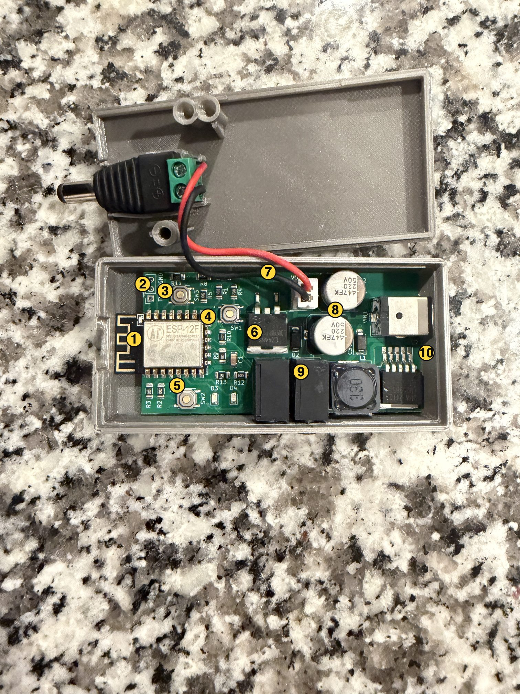
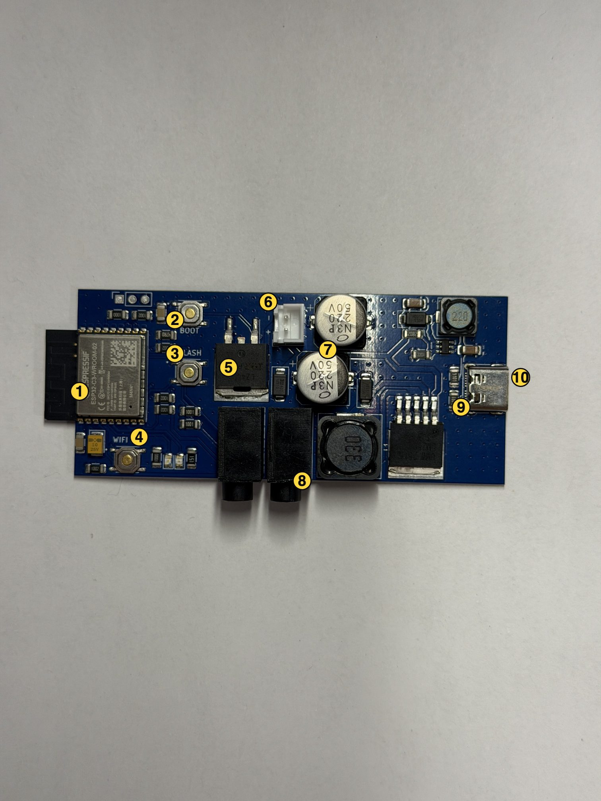
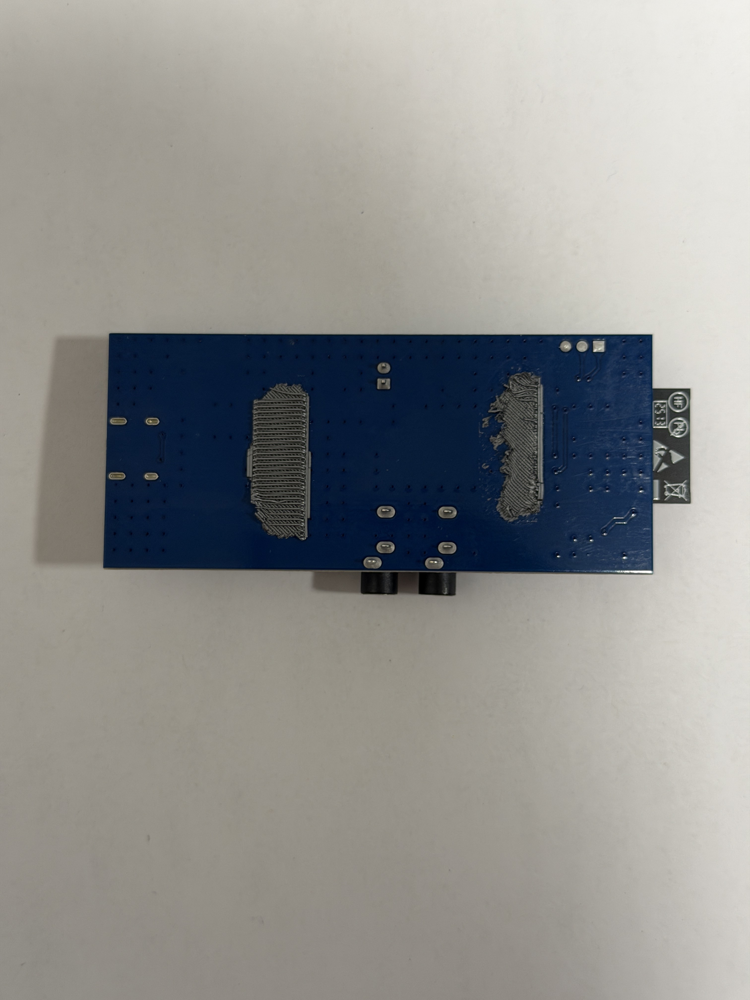

# OpenSmartTimer hardware reference

## Supported product generations

This firmware is specific to MagBound carrier boards. It is not generic ESP-12 or ESP32-C3 firmware.

| Product | Controller | Flash contract |
| --- | --- | --- |
| MagBound Smart Timer V1 (Legacy Timer) | ESP8266 ESP-12F | 4 MB, DOUT, 40 MHz, `4M/2M OTA` |
| MagBound Smart Timer V2 | ESP32-C3 | 4 MB, DIO, 80 MHz, two 1.25 MiB OTA slots |

Everything here was worked out by inspecting one unit of each model; other production runs may differ, and several circuits remain untraced. Electronic state and indicator LEDs cannot prove that an external lock mechanically released. Read the [safety, warranty, and liability notice](../SAFETY.md) before installation or use.

## GPIO maps

### V1 — ESP8266

| Function | GPIO | Direction | Active level | Firmware behavior |
| --- | ---: | --- | --- | --- |
| Lock driver A | 4 | Output | HIGH | Preloaded LOW; mirrored with GPIO13 |
| Lock driver B | 13 | Output | HIGH | Preloaded LOW; mirrored with GPIO4 |
| Blue status LED | 12 | Output | HIGH | Network and maintenance feedback only |
| Emergency input | 10 | Input | HIGH | Continuously commands release and blocks start/resume while asserted; see [Accessory jacks](#accessory-jacks) for the model-specific connector location |
| Reset button | 5 | Input | HIGH | Short release arms OTA; second short release permits one unverified upload; ten-second hold resets settings |

GPIO10 normally shares the ESP8266 flash interface. DOUT mode is therefore a compatibility requirement, not a performance preference.

#### V1 board layout



Photographed with the enclosure lid open. Callout numbers match the image
above; `images/board-v1-front-annotated.svg` is its editable overlay.

| # | Silkscreen | What it is |
| ---: | --- | --- |
| 1 | *(module label `AI ESP-12F`)* | ESP8266 **ESP-12F** module (AI-Thinker variant). PCB antenna trace to the far left. 4 MB in-package flash. |
| 2 | `TX RX GND` | 3.3 V UART service pads at the top-left. Inaccessible with the enclosure closed. Do not connect 5 V. |
| 3 | `SW3` (topmost switch) | **The user-accessible Reset button** (V1 GPIO5). The same physical function as V2's `WIFI RST` switch — silkscreen differs across board revisions but the role is identical. Short/medium/ten-second gestures below. |
| 4 | `SW1` | Internal programming control: holding it through an `SW2` reset selected ROM download mode on the inspected unit. Electrical routing remains untraced. See [V1 UART service](#v1-uart-service-observations). |
| 5 | `SW2` | Hardware reset for the ESP module (uptime and current-boot history restart). Not user-facing. |
| 6 | *(TO-252, `L74…`)* | Lock-driver MOSFET, gate driven by mirrored GPIO4 + GPIO13. |
| 7 | *(2-pin board connector, pigtail ending in a male barrel plug)* | **12 V lock output.** Carries the switched 12 V rail to the male barrel plug that feeds the magnets. It is an output: never connect a power supply to it. |
| 8 | *(2 × silver electrolytics, `220 50V`)* | 220 µF 50 V bulk capacitance for the coil-driver stage. |
| 9 | *(2 × black 3.5 mm jacks, bottom center)* | Owner identifies the jack **nearest the 12 V power-input barrel socket** as emergency release; the other jack is reserved. See [Accessory jacks](#accessory-jacks). |
| 10 | *(SOIC-8 IC + inductor `330`, right side)* | Buck converter producing the ESP-12F 3.3 V supply from the 12 V input. |

12 V DC power enters through the separate barrel socket at the right end of the
board (not numbered in the photo). The V1 therefore has two barrel connectors:
the socket is the power input and the male plug on the pigtail is the output to
the magnets. Whenever the lock is connected, feed the socket from a 12 V battery
pack, never from a mains adapter ([safety notice](../SAFETY.md#battery-power-only)).

The plastic tray around the V1 PCB is a 3D-printed enclosure that opens
at the top-right; the enclosure itself is not part of the electrical
contract.

#### V1 UART service observations

Two-way ROM communication was verified on one unloaded V1 with an external
FT232 adapter at **3.3 V logic, 115200 baud, 8N1, no flow control**. Use the
PCB signal labels: adapter RXD connects to timer TX, TXD to timer RX, and
GND to GND. Leave adapter VCC, DTR and RTS disconnected and use the timer's
normal power input. Keep the lock/load disconnected throughout service.

On the inspected V1, **hold `SW1`, press and release `SW2`, then release
`SW1`** to enter programming mode. A receive-only capture at 74880 baud
confirmed `boot mode:(1,1)` (UART download); earlier reset attempts produced
`boot mode:(3,0)` or `(3,1)` (flash boot). `SW2` is hardware reset.
These observed button functions do not independently trace their GPIO
routing. Release `SW1` before resetting back to normal operation.

With the timer already in programming mode, the following **esptool 4.5.1**
query succeeded; replace `<PORT>` with the adapter port. Replacing `chip_id`
with `flash_id` also succeeded:

```sh
esptool.py --chip esp8266 --port "<PORT>" --baud 115200 \
  --before no_reset --after no_reset --no-stub --connect-attempts 3 chip_id
```

The chip reported ESP8266EX, Wi-Fi and a 26 MHz crystal. Flash ID was
manufacturer `0x20`, device `0x4016`, detected size 4 MB. The crystal
frequency is separate from the configured 40 MHz flash clock. No stub was
uploaded and no firmware, settings or flash contents were written. These
queries left the unit in programming mode; they do not qualify reflashing
or recovery from a broken image.

The first 1 MiB of flash was subsequently read at 115200 baud with esptool's
temporary **RAM stub** (ESP8266 ROM alone cannot perform this read):

```sh
esptool.py --chip esp8266 --port "<PORT>" --baud 115200 \
  --before no_reset --after no_reset --connect-attempts 3 \
  read_flash --no-progress 0x0 0x100000 tmp/v1-program-region.bin
```

The eboot and application headers at `0x0` and `0x1000` specified DOUT,
4 MB and 40 MHz. The Arduino whole-image CRC validated, and the application
contained the V1 product marker. The first 4 KiB exactly matched the
[release verifier's](../scripts/release/verify_release.py) eboot baseline,
SHA-256 `2b84c131751a030115773d73137caa22bcd0f867e89e826a9567788ce022793a`.
No flash was written; filesystem and settings regions were not read.
A previous 460800-baud attempt failed with corrupt serial data, so only
115200 is validated here. A subsequent `read_flash_status` query did not
connect after stub exit. Re-entering ROM mode with the physical button
sequence allowed `read_flash_status` to succeed with `--no-stub`, using
the same options as the ID query above. It returned raw status `0x0000`;
no status bits or flash contents were written. This records the observed
value without assuming a device-specific status-register interpretation.

After releasing `SW1` and tapping `SW2`, a receive-only 115200-baud capture
showed `OpenSmartTimer firmware starting` and the owner confirmed the amber
indicator was fully off. This verifies return to the installed application,
not UART reflashing or broken-image recovery.

In ROM programming mode, the owner reported **both the amber lock indicator
and blue carrier-board indicator dimly lit**. A third LED near the ESP-12F module's antenna briefly
flashed during the ID queries, then went off; during the longer flash read,
the module's blue LED was mostly lit with blinking that appeared to track
the UART adapter's activity LED. Its circuit has not been traced.
Espressif documents [UART TX also appearing on GPIO2 in ESP8266 ROM download
mode](https://docs.espressif.com/projects/esptool/en/latest/esp8266/advanced-topics/boot-mode-selection.html);
if that LED is connected there, UART activity could explain the flash.
This is a possible explanation, not a verified LED assignment. The firmware's
carrier status LED remains GPIO12. Output voltage/current were not measured;
ROM-mode LED appearance does not establish whether the lock output is
energized or released, and application fail-open initialization is not
running in that mode.

### V2 — ESP32-C3

| Function | GPIO | Direction | Active level | Firmware behavior and validation |
| --- | ---: | --- | --- | --- |
| Lock driver | 3 | Output | HIGH | Preloaded LOW; commanded by the timer state machine |
| Amber lock indicator | 6 | Output | HIGH | Mirrors GPIO3 while OpenSmartTimer runs; never used for application maintenance patterns |
| Blue status LED | 5 | Output | HIGH | Network and maintenance status |
| Emergency input | 0 | Input | HIGH | Continuously commands release while asserted; physical jack attribution is unresolved, see [Accessory jacks](#accessory-jacks) |
| Reset/config button | 4 | Input | HIGH | Marked `WIFI RST` on the PCB; the interface calls it the **Reset button**. OTA, 3–5 second BLE pairing, and ten-second factory-reset gestures |
| Auxiliary input | 1 | Input | HIGH | Initialized but deliberately inactive; physical jack routing not verified |

These are product-specific assignments, not generic ESP32 development-board defaults. The V2 build uses ESP32-C3, Arduino-ESP32 3.3.0, ESP-IDF 5.5, 4 MB flash, 80 MHz, and DIO mode.

The owner identifies the inspected V2's jack **nearest the magnet/lock-output
connector** as emergency release; the other jack is spare. This is a different
connector landmark from V1's 12 V power input. See [Accessory jacks](#accessory-jacks)
for the physical-identification limits and the per-model comparison.

#### V2 board layout



Photographed board, front. Callout numbers match the image above; `images/board-v2-front-annotated.svg` is its editable overlay.

| # | Silkscreen | What it is |
| ---: | --- | --- |
| 1 | *(module label `ESPRESSIF ESP32-C3-WROOM-02`)* | ESP32-C3-WROOM-02 module. Chip ID 5, 4 MB in-package flash, 80 MHz, DIO mode. FCC/CE marking on the module lid. PCB antenna trace at the extreme left. |
| 2 | `BOOT` | Internal tactile switch. A tap restarted the inspected unit; switch routing remains untraced. See [V2 UART service](#v2-uart-service) for unloaded bench use. |
| 3 | `FLASH` | Internal tactile switch adjacent to `BOOT`. Holding it while tapping `BOOT` entered ROM download mode on the inspected unit; switch routing remains untraced. No application action assigned. |
| 4 | `WIFI RST` | **The user-accessible Reset button** (V2 GPIO4). The silkscreen calls it `WIFI RST`; the interface, this document, and every user-facing message call it the **Reset button**. |
| 5 | *(TO-252, `L74…`)* | Lock-driver MOSFET. Gate driven from GPIO3 via a small SOT-23 device just above it. |
| 6 | *(2-pin JST-XH, marked `+`)* | **12 V DC accessory output.** Polarized 2-pin connector that carries the on-board switched 12 V rail to an external barrel-jack pigtail (which then drives the magnetic-lock coil). Verify polarity on an unpowered board before wiring anything else. |
| 7 | *(2 × silver electrolytics, `N3P 220 50V`)* | Capacitors marked 220 µF, 50 V near the output stage. Component voltage ratings alone do not establish the actual rail voltage or wiring. |
| 8 | *(2 × black 3.5 mm jacks, bottom center)* | Owner identifies the jack **nearest the magnet/lock-output connector** as emergency release; the other jack is spare. Contact routing remains untraced; see [Accessory jacks](#accessory-jacks). |
| 9 | *(SOIC-8 IC + inductors, right of the caps)* | Switching converter that produces the 12 V accessory rail from USB-C 5 V input. A separate on-board regulator (small SOT-23 near the ESP module) generates the ESP32-C3 3.3 V supply. |
| 10 | *(USB-C receptacle, far right)* | 5 V power input over USB-C. Whenever the lock is connected, use a USB power bank, never a wall charger ([safety notice](../SAFETY.md#battery-power-only)). Data-line routing to the ESP32-C3 has not been electrically confirmed; treat as **power-only** until proven otherwise. |

The back of the board (photo below) is largely **residual 3D-printed
filament** left over from the vendor's glued enclosure — the two large
hatched patches are plastic that the board could not be cleanly removed
from, not copper heat-spreading pour. Genuine PCB features on the back
are limited to the two 3.5 mm jacks' through-hole solder pads (bottom
center) and a small cluster of pads near the left edge; anything else in
the photo is filament residue rather than routing. No serviceable
silkscreen is visible.



#### V2 PCB switches

Paralleling the V1 PCB switch table, on the photographed V2 board:

| Silkscreen | User-facing role | Firmware behavior |
| --- | --- | --- |
| `WIFI RST` | The Reset button (GPIO4), used for routine operation. | See "Reset button gestures" below for OTA, pairing and settings reset. |
| `BOOT` | Internal service control. | A tap produced a normal restart on the inspected unit. No application action assigned. |
| `FLASH` | Internal service control. | Holding it while tapping `BOOT` selected ROM download mode on the inspected unit. No application action assigned. |

The `BOOT` and `FLASH` switch circuits have not been traced, and other board
revisions may differ. Their observed service functions are described below;
use `WIFI RST` for routine operation. ROM communication has been tested, but
reflashing or recovery from a broken image has not.

#### V2 UART service

The three service pads above the ESP32-C3-WROOM-02 module were functionally
verified with a fitted header on **one unloaded V2 unit**. The repository
photo shows bare pads; a header may need fitting. With the antenna on the
left and USB-C on the right, the order is **TX — RX — GND** from left to right.

| Physical header position, counted from USB-C toward the antenna | Timer signal | USB–UART adapter connection |
| --- | --- | --- |
| 1 — nearest USB-C | GND | GND |
| 2 — middle | RX, GPIO20, module pad 11 | TXD |
| 3 — nearest antenna, furthest from USB-C | TX, GPIO21, module pad 12 | RXD |

Positions 1–3 are labels used here for orientation, not printed pin numbers,
GPIO numbers or module pad numbers. The module RX/TX assignments are listed
in the [Espressif module datasheet](https://documentation.espressif.com/ESP32-C3-Wroom-02_datasheet_en.pdf#page=11).
Do not assume the V1 header order or another V2 revision matches this unit.

> [!CAUTION]
> Keep the lock/load disconnected and no one attached throughout UART and
> ROM-download work. In ROM download mode the amber lock LED was dim but
> solid. Its cause is unknown; lock-output voltage and current were not
> measured. OpenSmartTimer is not running in that mode, so its fail-open
> GPIO initialization does not apply. LED appearance cannot establish that
> the output is safe to connect.

The tested adapter was a DSD TECH SH-U09C5 (FT232), set to **3.3 V UART logic**.
Use **115200 baud, 8 data bits, no parity, 1 stop bit, no flow control**.
Leave adapter VCC, DTR, RTS and every other adapter pin disconnected; power
the timer through its normal USB-C input. Never apply 5 V UART logic.

To check communication without changing firmware:

1. With both USB cables unplugged, first connect only adapter GND to timer
   GND and adapter RXD to timer TX. Connect the adapter's USB cable and open
   its serial monitor, then power the timer through USB-C. Coherent ESP32-C3
   ROM text followed by
   `OpenSmartTimer firmware starting` confirmed timer TX on the tested unit.
2. Unplug both USB cables before adding adapter TXD to the middle timer RX
   pin. Reconnect power and the monitor. A tap of the internal `BOOT` button
   alone produced normal startup on the tested unit.
3. Hold `FLASH`, tap and release `BOOT`, wait one second, then release
   `FLASH`. The tested unit printed `boot:0x5 (DOWNLOAD(USB/UART0/1))` and
   `waiting for download`. If the expected output is absent, stop and
   recheck the board revision and wiring.
4. Close the serial monitor so it releases the port. The following read-only
   query succeeded with **esptool 4.5.1**; this example uses **4.x syntax**.
   Replace `<PORT>` with the adapter's serial port:

   ```sh
   esptool.py --chip esp32c3 --port "<PORT>" --baud 115200 \
     --before no_reset --after no_reset --no-stub --connect-attempts 3 chip_id
   ```

   The chip answered as ESP32-C3 revision v0.4 with a 40 MHz crystal and
   Wi-Fi/BLE. ESP32-C3 has no separate ChipID, so this command reports its
   MAC instead. A successful reply confirms both UART directions, including
   the middle RX pin. No stub was uploaded and no flash, eFuses, settings or
   firmware were written.
5. Reopen the monitor and tap `BOOT` with `FLASH` released to return to the
   application. Normal firmware startup was captured again on the tested
   unit, and the amber LED was then confirmed fully off.

##### Read-only metadata queries

While in ROM mode with the monitor closed, before step 5, the same esptool
4.5.1 command prefix can read service metadata. Replace the final `chip_id`
with one of the suffixes below. Create the ignored `tmp/` directory first
and keep raw reads private; do not commit vendor images or captures.

| Command suffix (esptool 4.x syntax) | Observation on the tested unit |
| --- | --- |
| `flash_id` | JEDEC manufacturer `0x5e`, device `0x4016`; detected flash size 4 MB |
| `get_security_info` | Raw flags `0x00000000`, `Flash_Crypt_Cnt` `0x0`, ROM `Chip_ID` 5 and API version 3 |
| `read_flash_status` | Raw status `0x0200` |
| `read_flash --no-progress 0x8000 0x1000 tmp/v2-partition-table-sector.bin` | 4 KiB partition-table sector; validated MD5 footer and [matching layout](#v2) |
| `read_flash --no-progress 0xe000 0x2000 tmp/v2-otadata.bin` | 8 KiB OTA metadata; both record CRCs valid, both states `VALID` |
| `read_flash --no-progress 0x0 0x8000 tmp/v2-bootloader-region.bin` | 32 KiB before the partition table; bootloader checksum and embedded SHA-256 validated |
| `read_flash --no-progress 0x10000 0x200 tmp/v2-app0-header.bin` | App 0 header and descriptor |
| `read_flash --no-progress 0x150000 0x200 tmp/v2-app1-header.bin` | App 1 header and descriptor |

ROM `Chip_ID` 5 identifies the ESP32-C3 chip type; it is not a unique device
ID. The raw security/status values above are observations on this unit,
not a security assessment or a statement about signed application OTA.
No keys, NVS contents or filesystem contents were read.

All three image headers reported DIO, 80 MHz, 4 MB, chip type 5 and
`hash_appended=1`. Both app descriptors contained version `afa5cdd-dirty`,
project `arduino-lib-builder` and IDF string `b66b5448`, with blank compile
date/time. These descriptor strings do not identify the installed product
firmware version; use the device UI/API for its version and build identity.
Valid OTA records are a snapshot of selection metadata, not proof of the
runtime slot or automatic rollback. Do not write OTA metadata to test recovery.

These checks verify external UART ROM access and read-only inspection, not
firmware restoration or recovery from a non-booting image. No stub was
uploaded or flash, eFuses, settings or firmware written. Native USB-C data
routing remains unverified; treat that connector as power-only.

#### V2 PCB connectors

| Position | Connector | Purpose | Verification status |
| --- | --- | --- | --- |
| Far right | USB-C receptacle | Board power in (5 V). Data-line routing to the ESP32-C3 is **not** electrically confirmed by this document. | Power ingress exercised on one unloaded unit; enumeration as a USB device not tested. |
| Above ESP module | 3 UART service pads; header fitted on tested unit | 3.3 V UART0 service connection; see [V2 UART service](#v2-uart-service). | TX/RX communication verified with an external FT232 adapter on one unloaded unit. |
| Top center | 2-pin JST-XH (polarized, `+` marked) | **12 V DC accessory output.** Carries the on-board switched 12 V rail to an external barrel-jack pigtail that drives the magnetic-lock coil (switched by the GPIO3-driven MOSFET). | Confirmed as the 12 V accessory output; polarity pinout not electrically re-verified in this document. |
| Bottom center, jack nearest magnet/lock-output connector | 3.5 mm socket; contacts unverified | Owner-reported emergency input; see [Accessory jacks](#accessory-jacks). | Contact-to-GPIO routing untraced. |
| Bottom center, other jack | 3.5 mm socket; contacts unverified | Spare under investigation. | No verified GPIO assignment or socket pole count. |

Do not apply external voltage to the 2-pin JST or either 3.5 mm jack
based on this document. Trace the carrier circuit on an unpowered
disconnected board before wiring anything but a compatible dry-contact
accessory or the intended magnetic-lock coil.

## Accessory jacks

Use the **model-specific connector landmarks** below. On the inspected
boards, the owner identifies V1 emergency release by proximity to the
**12 V power input**, and V2 emergency release by proximity to the
**magnet/lock output**. V1's power input is the fixed barrel socket, not the
movable male lock-output pigtail. V2's magnet output is the on-board 2-pin
connector feeding that output's pigtail.

These owner clarifications supersede earlier inconsistent left/right
descriptions. They are not a new contact-to-GPIO trace or socket pole-count
verification. Identify the emergency jack on the actual unit with the
controlled load disconnected, and test the connected accessory before every
use. Do not infer jack function from viewing direction or `Accessories 1` /
`Accessories 2` numbering.

| | V1 | V2 |
| --- | --- | --- |
| Emergency jack, owner-identified | **Nearest the 12 V power-input barrel socket** | **Nearest the magnet/lock-output connector** |
| Firmware emergency input | GPIO10, active HIGH | GPIO0, active HIGH |
| Other jack | Reserved; no verified GPIO assignment | Spare; no verified GPIO assignment. Firmware GPIO1 remains deliberately inactive |

Do not apply external voltage to either jack based on this document. Use only a compatible dry-contact accessory until the carrier circuit and plug contacts are electrically traced.

## Fail-open initialization

Both target builds call the timer controller before Serial, EEPROM, Wi-Fi, or HTTP initialization. Output latches are written LOW before their pins switch to output mode:

- V1: GPIO4 and GPIO13 LOW.
- V2: direct ESP-IDF latch writes preload GPIO3 and GPIO6 LOW before Arduino enables output mode; successful writes are required by the delayed OTA-confirmation gate.

The firmware does not restore an active timer after reset. A held emergency input is read during initialization, remains release-enforcing, and rejects a later start without requiring a new edge. V2 GPIO1 cannot start a timer in this build.

## Indicators

While OpenSmartTimer is running, the amber indicator represents the
commanded lock-driver state:

- Amber on: firmware is commanding the lock output energized.
- Amber off: firmware is commanding release.

This interpretation does not apply during reset or ROM download mode. A
dim, solid amber LED was observed in V2 ROM download mode with output
voltage/current unmeasured; see [V2 UART service](#v2-uart-service).

While OpenSmartTimer is running, the blue indicator reports network state unless a higher-priority maintenance pattern is active:

| Blue pattern | Meaning |
| --- | --- |
| Solid | Connected to router Wi-Fi, or intentional standalone AP Mode is available |
| 500 ms on / 500 ms off | Recovery AP is available because saved Wi-Fi cannot be reached |
| Fast 150 ms blink | Neither router Wi-Fi nor an AP is currently available |
| Rapid 125 ms blink for five seconds | Identify request |
| Solid during transfer and validation | Firmware upload is in progress |
| Rapid 80 ms on / 80 ms off | Firmware accepted; restart is pending |
| Two short flashes every two seconds | OTA armed |
| Three short flashes every two seconds | One unverified firmware upload permitted |
| One slow flash every 1.6 seconds | V2 Bluetooth pairing is waiting for an app |
| Pairing confirmation pattern | V2 app is connected and waiting for a short Reset press |
| Warning blink accelerating after eight seconds | Reset button is held toward the ten-second settings reset |

Maintenance patterns are accepted only while the timer is open. OpenSmartTimer never uses amber for maintenance feedback because it follows the lock command.

## Reset button gestures

The interface calls the user-accessible control the **Reset button**,
regardless of what the PCB silk-screen calls it. V1's topmost switch is
labeled `SW3`; V2's is labeled `WIFI RST`. They are the same button in
different silk-screen conventions.

- Release within two seconds while open: arm OTA for five minutes.
- Release a second time during that window: permit one structurally compatible but otherwise unrecognized application image.
- On V2, release after 3–5 seconds while open: enable Bluetooth and open a two-minute app-pairing window.
- Hold ten seconds while open: reset router Wi-Fi, AP configuration, device name, and supported Bluetooth settings, then restart with a generated open AP.

The ten-second operation does not change firmware or erase the retained filesystem.

### V1 PCB switches

On the inspected V1 PCB:

| PCB marking | Current status |
| --- | --- |
| `SW3` | User-accessible Reset button used by firmware |
| `SW2` | Functionally confirmed hardware reset: uptime and current-boot history restart |
| `SW1` | Holding through an `SW2` reset selected ROM download mode on the inspected unit; electrical routing remains untraced |
| UART pads labeled `TX`, `RX`, `GND` | Visible 3.3 V service pads; follow the PCB labels. Inaccessible in the assembled enclosure |

Leave V1 `SW1` released during routine resets and updates. Hold it through
reset only for intentional unloaded [UART service](#v1-uart-service-observations).
Continuity mapping must be performed only on an unpowered, disconnected board.

### V2 PCB switches

`WIFI RST` is the Reset button for routine operation. The internal `BOOT`
and `FLASH` controls were functionally tested only for unloaded restart and
ROM access; see [V2 UART service](#v2-uart-service). Their electrical routing
remains untraced.

## Flash layouts and rollback

### V1

The [V1 build configuration](../platformio.ini) selects Arduino ESP8266
3.1.2's [eagle.flash.4m2m.ld](https://github.com/esp8266/Arduino/blob/3.1.2/tools/sdk/ld/eagle.flash.4m2m.ld).
The [project flash contract](../include/flash/MagBoundV1Esp8266.h) caps the
complete uploaded image at 1,044,464 bytes (`0xFEFF0`), including eboot at
offset zero and the application header at `0x1000`.

The [UART read](#v1-uart-service-observations) confirmed the inspected V1's
eboot baseline and application header at `0x1000`. The remaining region
boundaries below come from the project/Arduino source layout; the read did
not extend into the filesystem or settings. All ranges are physical offsets
with **exclusive ends**; subtract `0x40200000` from the linker's mapped flash
addresses to obtain physical offsets.

| Region | Start | End, exclusive | Purpose |
| --- | ---: | ---: | --- |
| eboot sector | `0x000000` | `0x001000` | Bootloader and image padding |
| Application and OTA workspace | `0x001000` | `0x200000` | Application extent and temporary update placement vary with image size |
| Retained filesystem area | `0x200000` | `0x3FA000` | 2,072,576 bytes (2,024 KiB) in the configured layout |
| Alignment gap | `0x3FA000` | `0x3FB000` | Excluded from the configured filesystem; contents not established |
| EEPROM emulation | `0x3FB000` | `0x3FC000` | Fixed 4 KiB sector; OpenSmartTimer uses 512 bytes |
| RF calibration | `0x3FC000` | `0x3FD000` | Arduino/SDK calibration sector |
| SDK system parameters | `0x3FD000` | `0x400000` | Final three sectors |

V1 uses linker-defined regions rather than a V2-style partition table or
two fixed application slots. Arduino's [Updater](https://github.com/esp8266/Arduino/blob/3.1.2/cores/esp8266/Updater.cpp)
stages an application upload at `0x200000 - alignUp(uploadSize, 4096)` and
rejects overlap with the sector-rounded current image. On successful
completion it stores an RTC-memory command for eboot to copy the staged
image to offset zero on restart. This copy-and-replace process does not
establish automatic rollback or recovery after an interrupted update.

The default [EEPROM backend](https://github.com/esp8266/Arduino/blob/3.1.2/libraries/EEPROM/EEPROM.cpp)
uses `0x3FB000`, followed by RF calibration and SDK settings; it is not the
last flash sector. [Device configuration](../src/DeviceConfig.cpp) uses that
fixed backend on V1. Routine application OTA does not intentionally write
the retained filesystem or EEPROM sectors. Web OTA back to a matching
vendor V1 application has been completed successfully on physical hardware.

### V2

An external UART ROM read of the partition-table sector at `0x8000`
confirmed this layout on one unloaded V2. Its MD5 footer was validated,
all entry flags were zero, and all six offset/size pairs matched the
project's generated table and [release verifier](../scripts/release/verify_release.py):

| Partition label | Type / subtype | Offset | Size |
| --- | --- | ---: | ---: |
| `nvs` | `data / nvs` | `0x009000` | `0x005000` (20 KiB) |
| `otadata` | `data / ota` | `0x00E000` | `0x002000` (8 KiB) |
| `app0` | `app / ota_0` | `0x010000` | `0x140000` (1,280 KiB) |
| `app1` | `app / ota_1` | `0x150000` | `0x140000` (1,280 KiB) |
| `spiffs` | `data / spiffs` | `0x290000` | `0x160000` (1,408 KiB) |
| `coredump` | `data / coredump` | `0x3F0000` | `0x010000` (64 KiB) |

The retained bootloader read from `0x0` contained a 13,216-byte (`0x33A0`)
image, including its appended hash, followed by erased `0xFF` padding up to
`0x8000`. Its checksum and embedded SHA-256 validated. The SHA-256 of the
exact image including the appended hash, excluding padding, was
`2bf90d2741124ebd00c41b9dc2c8bc881398258ed4bc12acdb6e758134a78363`.
This fingerprints the observed bootloader; it does not establish its build
configuration or qualify automatic rollback.

The V2 OTA application image begins at its application slot; it is not a merged whole-flash image. Two slots allow OTA replacement but do not by themselves guarantee automatic rollback after a bad boot. The original filesystem is not included or redistributed. OpenSmartTimer configuration uses the dedicated NVS namespace `opensmarttimer`; the V1 build uses its existing fixed EEPROM sector because ESP8266 EEPROM emulation has no named namespace.

Application-only web OTA from the tested OpenSmartTimer V2 baseline back to the exact vendor 0.3.0 application completed successfully, and the retained vendor filesystem remained usable. Automatic rollback before the OpenSmartTimer web updater becomes reachable remains unverified and should not be treated as a recovery procedure.

External [UART ROM access](#v2-uart-service) has been verified on one unloaded
V2, but UART reflashing and recovery from a broken image remain untested.
The USB-C connector's data routing remains unverified; treat it as power-only
until enumeration or electrical tracing confirms otherwise.

## Bluetooth

The V2 ESP32-C3 firmware includes a
NimBLE peripheral with encrypted bonding, persistent application
authentication, integrity-protected control, status/event notifications,
Identify, and physical no-Wi-Fi pairing. The radio preference, three approved
app credentials, and bonds survive restart until explicitly revoked or
factory-reset. The application permits one inbound connection, and the
framework is built for that single link with four bonds, the extra bond
reserved for pairing replacement. Central, scanner and GATT-client support is
not compiled in; timer discovery and mirroring are not implemented.
Authenticated management includes settings and physically armed OTA.
The ESP8266 V1 has no BLE support. See [Bluetooth Low Energy design](BLUETOOTH.md)
for UUIDs, frames, authentication, validation, security limitations, and the
unimplemented two-timer control boundary.

See [Installation](INSTALLATION.md) before replacing or restoring firmware.
