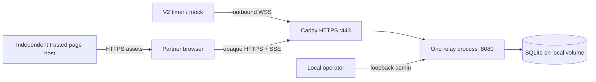

# Operating the relay

This runbook covers the example server, the partner page, the mock timer and
connecting a V2 timer (whose relay support is experimental and off by
default). See the [relay overview](README.md) for status and the timer side.

The relay is experimental and provided as is, without warranty. Running one,
especially for other people, is your own responsibility; read
[SAFETY.md](../SAFETY.md) first.

## 1. Tested deployment shape

Use one FastAPI/Uvicorn process, one SQLite database on local persistent disk,
and an HTTPS reverse proxy. The supplied Compose file adds an optional Caddy
service. The timer initiates WSS; the browser uses HTTPS commands and SSE.



The connected sockets and bounded pending opaque requests live in that process.
Adding workers or replicas would split routing state; it requires a separate
routing/pubsub design first. Process memory is not shared automatically.
[FastAPI deployment concepts](https://fastapi.tiangolo.com/deployment/concepts/)

SQLite WAL is sufficient for this tested development workload. Keep it on local
disk, use the backup API, and account for its single-writer behavior before
increasing load. [SQLite WAL documentation](https://www.sqlite.org/wal.html)

## 2. Configuration and HTTPS

From `relay/`:

```sh
cp .env.example .env
chmod 600 .env
python3 -c "import secrets; print(secrets.token_hex(32))"
python3 -c "import secrets; print(secrets.token_hex(32))"
```

Set a different generated value for `OSTRELAY_ADMIN_TOKEN` and
`OSTRELAY_COOKIE_SECRET`. Set `OSTRELAY_PUBLIC_URL=https://your-host` and
`OSTRELAY_HOSTNAME=your-host`. The URL must be an origin without a path, query,
credentials or fragment. The cookie secret must be exactly 64 hex characters;
it protects owner/OIDC sign-in state only. Set `OSTRELAY_PARTNER_ORIGIN` to the
exact independently hosted HTTPS page origin, different from the relay.

Supply `relay/certs/fullchain.pem` and `relay/certs/key.pem` for that hostname.
The example uses an operator-provided certificate; automatic issuance/renewal
is not configured. Restrict private-key permissions, with read access for the
Caddy container. Do not commit certificates, private keys or `.env`.

Timers recognise the relay by the public key in its certificate. With a
certificate from a public certificate authority, leave `OSTRELAY_SPKI_PIN`
empty: the relay reads the key from its own public URL, puts it in each setup
code, and follows renewals by itself. If the container cannot reach that URL,
point `OSTRELAY_TLS_PROBE_ADDRESS` at the proxy (`caddy:443` for the bundled
profile); the public hostname is still what gets validated.

For a private or self-signed certificate, name the key yourself. Extract the
pin from the **leaf certificate** you will actually serve:

```sh
openssl x509 -in certs/fullchain.pem -pubkey -noout \
  | openssl pkey -pubin -outform der \
  | openssl dgst -sha256 -binary \
  | openssl base64 -A | tr -d '=' | tr '/+' '_-'
```

Put this base64url SHA-256 SPKI value in `OSTRELAY_SPKI_PIN`; several pins may
be separated by commas. Startup requires HTTPS and, when a pin is given, a
correctly sized one. A configured pin is not compared with the certificate
actually served; the mock verifies that match.
`OSTRELAY_DEV_MODE=true` permits an explicitly selected loopback/testserver
origin for source tests. Production Compose does not enable this exception.

```sh
docker compose --profile https up -d --build --wait
curl --fail https://your-host/api/v1/health
curl --fail http://127.0.0.1:8080/api/v1/health
```

The application container runs as a non-root user, with a read-only root
filesystem, a writable data volume, 256 MiB memory limit and rotating logs.
Runtime dependencies are pinned with hashes in `requirements.lock`; Python
and Caddy base images are pinned by digest. Build tooling and host development
extras are not a claim of bit-for-bit reproducible builds.

For an existing reverse proxy, start only `relay` and adapt
[ops/Caddyfile](ops/Caddyfile), or use the Traefik example below. Forward only `/`,
`/assets/*`, `/api/v1/*`, `/setup`, `/setup/*`, `/owner` and `/owner/*`; leave
`/admin`, `/docs` and `/openapi.json` private. Preserve WebSocket upgrades, flush
SSE promptly and allow long-lived connections. The supplied Caddy rules set
`flush_interval -1` and disable caching. [Caddy proxy documentation](https://caddyserver.com/docs/caddyfile/directives/reverse_proxy)

### Behind Traefik

[docker-compose.traefik.yml](docker-compose.traefik.yml) is an example override
for a Traefik instance you already run. It attaches the relay to Traefik's
Docker network and publishes the same public paths as the Caddy rules, so
`/admin`, `/docs` and `/openapi.json` stay on the local admin port only.

```sh
docker compose -f docker-compose.yml -f docker-compose.traefik.yml up -d --build --wait
```

Leave out `--profile https`. In `.env`, set `OSTRELAY_TRAEFIK_NETWORK` to the
network Traefik watches and `OSTRELAY_TRAEFIK_IP` to Traefik's own address on
it; give Traefik a fixed address there, because the relay accepts
`X-Forwarded-For` from that address alone.

Leave `OSTRELAY_SPKI_PIN` empty. The relay then reads the key of the certificate
Traefik serves for its hostname and follows renewals by itself, so a
certificate resolver such as Let's Encrypt works without any pin to maintain.
If the relay container cannot reach its own public address (split DNS, or an
allow-list on the entrypoint), set `OSTRELAY_TLS_PROBE_ADDRESS` to Traefik on
the shared network, for example `traefik:443`. Until the relay has read the
key it accepts no timers and the admin page shows **TLS key not known yet**.

Do not put forward-auth or single sign-on middleware on `/api/v1/`: timers and
partner browsers authenticate inside the relay protocol and cannot complete a
browser login. To keep enrollment and owner sign-in off the Internet, split the
router as the comment in the example describes.

### Independent trusted partner service

Choose an independent HTTPS origin for `spa/` and set `OSTRELAY_PARTNER_ORIGIN`
to that origin for exact browser CORS and setup-code generation. The single
setup code contains the relay origin, enrollment code, public SPKI pin and
suggested control-page origin. The owner reviews the two addresses on the local
timer page and briefly presses Reset to approve that exact setup within 60
seconds. No server hosting address or CI hosting variable is needed to build
firmware. Changing saved hosting configuration requires another locally
reviewed, physically approved setup. Relay responses cannot change it.
The timer refuses identical page/API origins, including equivalent host case
and default ports. A different path on the same origin is insufficient.
Do not serve partner assets from the relay, redirect links through it, or grant
the relay credentials that can change the trusted page.

Users operate this service themselves or select an operator they trust. The
project does not provide hosting. Partners need only the owner's share link:
`https://control.example.com/s/<public-id>#relay=<encoded-api-origin>&cap=<secret>`.
The public path ID cannot authorize control. Neither the secret fragment nor
the complete link is sent to the routing backend. Keep live links and
deployment credentials private.

`partner/compose.yml` provides a standalone static-page service on port 8444
for local evaluation. Give it its
own `OSTPARTNER_HOSTNAME`, `OSTPARTNER_RELAY_ORIGIN` and `OSTPARTNER_CERT_DIR`
containing `fullchain.pem` and `key.pem`. The container drops every
capability, so on Linux its root user reads that directory and key only through
ordinary file permissions. Make them owned by the account that root inside the
container maps to: root for standard Docker (`chown -R root:root` on the
directory, `chmod 600` on the key), or your own user for rootless Docker or
Podman. It mounts only trusted static assets,
its Caddy config and its own certificate directory. Start it with a separate
Compose project and env file; it needs no relay database, token or private key.
Use certificates trusted by your clients. Synthetic tests use their own local
CA; that trust setup does not establish public-browser trust.

Production requires a separate host/account with independent deployment access
and TLS keys. A container on the relay host does not protect the page against
host or shared Docker-daemon compromise. Relay API traffic remains opaque, but
public grant metadata and timing are visible and denial of service is possible.

## 3. Admin and enrollment

A timer connects with a **setup code**: one string with the relay address,
independent control-page origin, enrollment code and certificate SPKI pin.
The owner pastes it into
the timer page (Settings → Remote sharing; see
[docs/REMOTE_SHARING.md](../docs/REMOTE_SHARING.md)). Enrollment is the only
step that needs one; share links are created on the timer afterwards.

`OSTRELAY_ENROLLMENT` picks who may enroll:

| Value | Use it for | How owners get a setup code |
| --- | --- | --- |
| `owner_codes` (default) | Your own relay (homelab), or one you run for friends | Each owner has a **reusable** code for all their timers. On first start the relay creates the first owner (`owner`) and prints their setup code once in the log: `docker compose logs relay`. Invite more owners with `--invite`. |
| `open` | A community relay anyone may use | Anyone opens `https://<host>/setup` and copies the relay's setup code. The browser's HTTPS check is what makes the pin on that page trustworthy. |
| `owner_codes,open` | Both | Both of the above. |

Limits: `OSTRELAY_MAX_ENROLLED_TIMERS` (default 100, all modes),
`OSTRELAY_MAX_TIMERS_PER_OWNER` (default 10),
`OSTRELAY_RATE_ENROLLMENTS_PER_IP_1H` (default 20 attempts, all modes) and
`OSTRELAY_RATE_OPEN_ENROLLMENTS_PER_IP_1H` (default 5, open mode). A full
relay answers `409 relay_full`. An open enrollment that never connects is
removed after `OSTRELAY_OPEN_ENROLLMENT_UNUSED_TTL_S` (default 24 hours) so
it cannot hold a slot; a timer that has connected once is never removed for
being offline.

**Homelab:** keep the default and copy the setup code from the first-start log.
Lost it? Print a new one (the old one stops working; enrolled timers stay):

```sh
docker compose exec relay python -m ostrelay.setup_code --rotate owner
```

**Friends relay:** one owner per person. They enroll every timer they own with
their code, and you can cut off one person without touching the others:

```sh
docker compose exec relay python -m ostrelay.setup_code --invite alex
docker compose exec relay python -m ostrelay.setup_code --list
docker compose exec relay python -m ostrelay.setup_code --rotate alex   # leaked code
docker compose exec relay python -m ostrelay.setup_code --revoke alex   # code off, timers removed
```

**Community relay:** start invite-only (owner codes) even when many people
use it. `OSTRELAY_ENROLLMENT=open` lets anyone enroll from
`https://<host>/setup` within the limits above; it has no approval step or
per-person quota yet, so a determined stranger can still fill free slots
faster than the reclaim window empties them. By design it does not give
control of enrolled timers. Treat open mode as experimental, size
`OSTRELAY_MAX_ENROLLED_TIMERS` for your host, and watch the admin page. The
page returns 404 unless open enrollment is on and the relay knows its TLS key
(set in `OSTRELAY_SPKI_PIN` or read from its own certificate).

**Owner sign-in (optional, OIDC):** point the relay at an identity provider
you already run and owners serve themselves at `https://<host>/owner`: sign
in, create their setup code (a new one replaces the old; connected timers
stay), and see or remove their own timers. Nobody signs in to the partner
page; share links work as before. Configure it with environment values (see
`.env.example`):

| Setting | Meaning |
| --- | --- |
| `OSTRELAY_OIDC_ISSUER` | Provider issuer URL (HTTPS). Setting it enables `/owner`. |
| `OSTRELAY_OIDC_CLIENT_ID`, `OSTRELAY_OIDC_CLIENT_SECRET` | A confidential client at the provider; redirect URI `<OSTRELAY_PUBLIC_URL>/owner/callback`. |
| `OSTRELAY_OIDC_ALLOWED_GROUPS` | Comma-separated groups allowed to become owners; empty allows every account at the provider. Add `groups` to `OSTRELAY_OIDC_SCOPES` when your provider needs it. |
| `OSTRELAY_OIDC_GROUPS_CLAIM`, `OSTRELAY_OIDC_SIGNING_ALG`, `OSTRELAY_OIDC_PROVIDER_NAME` | Claim name (`groups`), ID-token algorithm (`RS256`), button label. |

Example with PocketID: create an OIDC client with callback URL
`https://relay.example.com/owner/callback`, then set
`OSTRELAY_OIDC_ISSUER=https://id.example.com`, the client ID and secret,
`OSTRELAY_OIDC_SCOPES=openid profile email groups` and
`OSTRELAY_OIDC_ALLOWED_GROUPS=timer-owners`.

The relay uses the standard authlib client (authorization code with PKCE,
discovery, ID-token signature, issuer, audience and nonce checks); the issuer
and signing algorithm are pinned to your settings. Each sign-in becomes one
owner (listed as "Signs in" on the admin page); revoking that owner blocks
their next sign-in and removes their timers. `OSTRELAY_ENROLLMENT` must
include `owner_codes`. Without OIDC settings nothing changes: you give out
setup codes from the admin page or the command line as below.

**One-time code** (any mode): a single-use code valid for 15 minutes, for a
single timer without an owner:

```sh
docker compose exec relay python -m ostrelay.setup_code
```

These commands need no token: shell access to the relay host is the
authorization, and none of this is reachable over the internet.

**Or the admin page** (no command line): open `http://127.0.0.1:8080/admin/`
on the relay host and paste `OSTRELAY_ADMIN_TOKEN`. It invites, rotates and
revokes owners, creates one-time codes and lists enrolled timers. For a
homelab, **New code** on `owner` shows a new setup code if you lost the one from
the first-start log. Caddy never serves `/admin` publicly, and the page keeps
the token only in that browser tab.

### Public landing page

The landing, setup, owner and admin pages each have an English/Simplified
Chinese switch beside the light/dark switch. The choice is kept per browser
tab and changes presentation only; nothing is saved on the relay.

The root address (`/`) shows a short introduction: partners open their complete
share link; owners use a setup code. It does not list timers or grant access.
In admin, **Public landing page → Show the landing page** saves its visibility
in SQLite, takes effect immediately, and survives a relay restart. Hiding it
returns HTTP 404 with caching disabled. **Preview landing page** stays available
at `/admin/landing-preview` on the private admin address, including when `/` is
hidden. Like the admin sign-in screen, the preview has no secrets or inventory;
it is not an authenticated management endpoint. Keep `/admin/*` private.

`OSTRELAY_LANDING_PAGE_ENABLED` defaults to `true`. Set it to `false` and recreate
the relay container to force the public landing page off. This overrides the
saved admin preference; admin cannot turn it back on while the flag is false.
Setting it back to `true` restores the saved preference, not necessarily a
visible page. No `.env` file is rewritten by the UI.

These settings affect **only `/`**. Partner links on the trusted origin, timer connections,
and public enrollment (`/setup`, governed separately by `OSTRELAY_ENROLLMENT`)
continue to work. Public enrollment has its own live admin switch below.
The authenticated `GET /admin/site-settings` and `PUT /admin/site-settings`
with `{"landing_page_visible": false}` expose the same setting. Responses show
the saved preference (`landing_page_visible`), environment gate
(`landing_page_allowed`), and effective visibility (`landing_page_enabled`).

### Enrollment pause and administrative controls

`OSTRELAY_ENROLLMENT` is the hard policy: the admin cannot permit `open` unless
it is present there. When permitted, **Allow new public enrollments** pauses or
resumes anonymous registration immediately and persists across restart.
`/setup` returns 404 while paused; previously copied public setup codes are
rejected at enrollment. Existing timer registrations and share links continue
working. Invited owner codes and one-time operator codes are unaffected.
`GET /admin/enrollment-settings` and authenticated `PUT` with
`{"open_enrollment_requested": false}` expose the same control. Responses report
the saved request, environment permission and effective state.

Anonymous setup uses one public reusable code; each completed enrollment gets
an independent timer ID and secret. It creates no owner account. An owner
account (invited or OIDC) provides a reusable/rotatable setup code and an inventory
of its own timers; signed-in owners can remove their registrations. It does not
provide partner control or reconstruct share links. Share creation, extension
and device-side revocation remain local timer operations.

**Clear all timers** in admin requires confirmation, removes all reviewed
registrations plus their routing grants/sessions, and closes connected timers.
Owner accounts, owner codes and relay preferences are preserved. Every removed
timer needs new enrollment. The API is authenticated `DELETE /admin/timers`
with `{"confirmation":"clear_all_timers","inventory_revision":"<revision>"}`;
obtain the revision from `/admin/overview`. A changed inventory returns 409
without deleting anything, even when the number of timers stays the same.

Set `OSTRELAY_ADMIN_ENABLED=false` and restart to remove every admin page/API,
including assets, health and previews. Command-line setup helpers remain
available. The public proxy blocks `/admin` in either mode. OIDC signs owners
into `/owner`; it does not grant admin authority. The admin uses its separate
operator token and private listener. A real provider login must be validated
against your configured issuer, callback and group policy before deployment.

### Admin access and API

To use the page from another computer at home, set `OSTRELAY_ADMIN_BIND` to
the relay host's LAN address (for example `192.168.1.20`) and open
`http://192.168.1.20:8080/admin/`. The token then crosses your LAN without TLS,
so only do this on a network you trust, and never bind a public address or
`0.0.0.0` on an internet-facing host. From outside your network, use an SSH
tunnel instead: `ssh -L 8080:127.0.0.1:8080 relay-host`.

**Or the API** (the same bearer token against the localhost port). Set the
token in your shell without posting it into chat, shared logs or screenshots:

```sh
curl --fail -H "Authorization: Bearer $OSTRELAY_ADMIN_TOKEN" \
  -X POST http://127.0.0.1:8080/admin/enroll-code
curl --fail -H "Authorization: Bearer $OSTRELAY_ADMIN_TOKEN" \
  -H 'Content-Type: application/json' -d '{"name":"alex"}' \
  -X POST http://127.0.0.1:8080/admin/owners
curl --fail -H "Authorization: Bearer $OSTRELAY_ADMIN_TOKEN" \
  http://127.0.0.1:8080/admin/timers
```

`GET /admin/owners` lists owners; `POST /admin/owners/{name}/rotate` and
`/revoke` match the commands. Owner responses carry `owner_code` and
`setup_code`.

The response has `enrollment_code`, `expires_at_unix` and `setup_code`
(`ost-relay-setup:` + base64url JSON of this relay's public URL, the code and
the SPKI pin; empty until the relay knows its TLS key, from `OSTRELAY_SPKI_PIN`
or its own certificate). Developers can still
pass the three values to `POST /api/v1/relay/enroll` (or
`relay/tools/device_relay_check.py`) or the [mock CLI](mock-timer/README.md).

`GET /admin/tokens/{timer_id}` lists grants.
`POST /admin/tokens/{fp_hash}/revoke` terminates that grant's browser sessions.
`DELETE /admin/timers/{timer_id}` removes enrollment and disconnects it.
Server revocation blocks this server's access; it does not change the timer's
own link table. Owners revoke on the timer with `POST /api/v1/relay/links/revoke`.

## 4. Limits and observability

Defaults include 100 connected timers, 32 simultaneous hello handshakes, 1,000
browser sessions, eight sessions per token, 16 SSE subscribers per timer,
32 pending commands and 256 result entries per timer. Owner inventory is capped
at 1,000 records, with 1,000 owner sessions total and eight per owner. Expired
sessions are reclaimed before admission; a full owner/session table refuses
new sign-ins without removing existing sessions. These are resource caps,
**not tested capacity promises**. Results expire after five minutes. The full
default table is in the [protocol](../docs/RELAY_PROTOCOL.md#10-resource-bounds).

Command limits are 30 per session and 200 per timer per five minutes. Session
exchange allows ten attempts per ASGI peer per minute. These three settings are
exposed in Compose. With an untrusted forwarding header configuration, a
reverse proxy can appear as one shared peer. Do not blindly trust arbitrary
`X-Forwarded-For` values.

Slow and abusive clients (defaults; all `OSTRELAY_*` settings):

| Bound | Default |
| --- | --- |
| Request headers (Caddy `read_header`), idle keep-alive (Caddy `idle`) | 10 s, 2 min |
| Whole request body (`HTTP_BODY_TIMEOUT_S`) | 10 s |
| One WebSocket write to a timer (`WS_SEND_TIMEOUT_S`); a stuck write closes that connection | 10 s |
| One event write to a partner page (`SSE_SEND_TIMEOUT_S`); a stuck write ends that stream | 15 s |
| A command, including its write (`COMMAND_AWAIT_S`) | as configured |
| Open connections, including streams (`MAX_CONCURRENT_CONNECTIONS`); beyond it new ones get 503 | 1,024 |
| Frames from one timer (`RATE_TIMER_FRAMES_PER_MIN`); beyond it the timer is disconnected | 1,200 per minute |

SSE and WebSocket connections are long-lived by design, so there is no
whole-request or write timeout at Caddy. A slot (timer connection or partner
stream) is released on every exit path, including failed handshakes.
Per-client ingress limits beyond these still belong at the edge; measure
them before broad exposure.

Health reports liveness; it does not imply any timer is connected or fresh.
Use private `/admin/health`, container restarts/RSS/CPU and operator inventory
for diagnostics. Metrics export, alerting, disk-full drills, slow-client load,
long soaks and WAN/mobile-browser coverage remain future work. No detailed
security audit trail or tamper-evident log is implemented.

Avoid request-body logging. Enrollment and owner/OIDC requests contain secrets;
partner requests carry public routing metadata and encrypted endpoint frames.
The full share capability stays in the trusted page's URL fragment and is never
sent to the relay. The default Caddyfile has no access log, but Uvicorn may log
watch URLs containing the nonsecret session handle. Keep logs private and
rotated; never add capabilities, enrollment secrets or encryption keys to them.

## 5. Backup and restore

The data volume contains SQLite, including WAL sidecars while running. Back up
with [ops/database.py](ops/database.py), which uses SQLite's online backup API,
checks integrity and refuses to overwrite a destination. A raw copy of only
the live `.sqlite` file is not a consistent backup method.

From `relay/`, choose a **new** snapshot filename each time:

```sh
mkdir -p backups
docker compose exec -T relay python /opt/ostrelay/ops/database.py \
  backup /data/ostrelay.sqlite /data/snapshot-001.sqlite
docker compose cp relay:/data/snapshot-001.sqlite backups/snapshot-001.sqlite
chmod 600 backups/snapshot-001.sqlite
```

For restore, stop the relay service while retaining its container and volume.
Copy a backup in, restore to a new database name, then select that name in
`.env`. Keep the old file for rollback. Never use `down --volumes` on an
operator deployment as a restore step.

```sh
docker compose stop relay
docker compose cp backups/snapshot-001.sqlite relay:/data/restore-source.sqlite
docker compose run --rm --no-deps --entrypoint python relay \
  /opt/ostrelay/ops/database.py restore /data/restore-source.sqlite /data/restored.sqlite
# Set OSTRELAY_DB_PATH=/data/restored.sqlite in .env.
docker compose up -d --wait relay
```

Adjust source paths after selecting a different database. Backups include
timer enrollment secrets and public routing/grant metadata. Keep the owner
cookie secret separately private. Treat all historical snapshots as sensitive:
schema migration does not sanitize existing backups. Timer capability/signing
private keys are not in the relay DB.
Restore only reconstructs the snapshot's state. Revocations made after that
snapshot must be reapplied before reopening access. A restored database does
not restore in-memory command history or prove a previously timed-out action
did not happen.

## 6. Restart and key rotation

- A relay restart preserves enrollment/grant/session rows on the volume but
  drops sockets, rate buckets and pending request routing. Timers reconnect;
  browser controls wait for a fresh authenticated device challenge response.
  Result history remains bounded device RAM, not a server plaintext cache.
- A timer reboot changes its boot ID and invalidates its previous links.
  The C++ result ring is RAM only; it survives a reconnect in the same boot,
  not a process restart or power loss.
- Rotating the cookie secret invalidates owner/OIDC login state. Partner traffic
  keys are derived at endpoints and do not depend on that secret.
- Rotate the admin token independently. Timer enrollment secrets require
  deletion/re-enrollment if compromised.
- Certificate renewal, including a new key, needs nothing from timer owners.
  Enrolled timers authenticate the relay with their enrollment secret, bound
  to whichever key the connection presents, so they reconnect by themselves.
  With `OSTRELAY_SPKI_PIN` empty the relay notices the new certificate within
  ten minutes, or at once when a timer arrives bound to it. With a configured
  pin, update the variable and restart when the key changes. Setup codes made
  before the change stop working for new enrollments; issue new ones.
- The enrollment secrets in the database are what timers trust. A relay
  rebuilt without its database is a stranger to every timer
  (`relay_auth_failed`) and each must be set up again. Back the database up.
- Timers do not validate certificates against a certificate authority (no CA
  bundle fits the V2 image). That is a deliberate model, not disabled
  verification: enrollment is pinned and every later connection is mutually
  authenticated.

## 7. Verify deployment

After starting or reloading your reverse proxy, check the live origins rather
than relying only on image health or source tests:

```sh
python3 relay/tools/deployment_smoke.py --relay https://api.example.com \
  --partner https://control.example.com
```

This verifies system TLS trust, every referenced page asset, the trusted shell
and deep routes, and public admin/partner-code isolation. Use `--landing-hidden`
when `/` is intentionally disabled. Private CA deployments may explicitly pass
`--relay-ca` and `--partner-ca`; that does not qualify public-browser trust.
The control shell is at `/s/`; usable control requires the full owner share link.
Never use a TLS verification bypass to qualify a production deployment.

For source changes, [relay tests](tests/README.md) provide a disposable HTTPS
stack with synthetic timers. Those tests do not establish your deployed
certificate trust, hosting isolation, WAN behavior or physical timer behavior.
